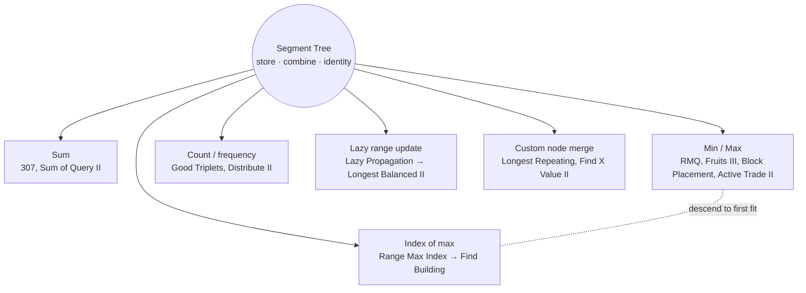

# Segment Tree: Pattern Map

> [!TIP]
> **🧠 One picture to keep**
> A **company org chart**: each manager knows a summary of their team (sum / min / max / index / custom card).
> A range question asks a few managers; a change at the bottom travels up one chain of managers. Both are **O(log n)**.
> One template, three knobs: **what a node stores**, **how two nodes combine**, **the identity for "no overlap"**.

**All animations:** [▶ Segment Tree Animations](https://d9-cell.github.io/java-brain/Segment%20Tree/Segment%20Tree%20Animations.html) · ⬆ [00 Brain Map](../00%20Brain%20Map.md)

## Java toolkit
| Piece | Java template (node i covers [l, r]) |
|---|---|
| Storage | `int[] tree = new int[4 * n];` children `2*i+1`, `2*i+2` |
| Mid | `int mid = (l + r) >>> 1;` |
| Query | `if (r < ql \|\| l > qr) return ID; if (ql <= l && r <= qr) return tree[i]; return f(left, right);` |
| Point update | go to the leaf, then `tree[i] = f(tree[2i+1], tree[2i+2])` on the way up |
| Range update | lazy array + `push(i, l, r)` at the start of every visit |
| Custom node | `static class Node {...}` + `merge(L, R)` (order matters!) |
| Coordinates up to 1e9 | compress: `int[] sorted = Arrays.stream(a).distinct().sorted().toArray(); Arrays.binarySearch(sorted, v)` |

## Patterns in this folder

| # | Problem | Pattern | Mantra | Level |
|---|---|---|---|---|
| 1 | [Range Sum Query - Mutable](Range%20Sum%20Query%20-%20Mutable.md) | Sum segment tree, Point update | NO → 0, FULL → NODE, PARTIAL → BOTH KIDS | Medium |
| 2 | [Range Minimum Query](Range%20Minimum%20Query.md) | Min segment tree | COMBINE = MIN, IDENTITY = +∞ | Medium |
| 3 | [Range Maximum Index Query](Range%20Maximum%20Index%20Query.md) | Index segment tree | STORE INDEX, COMPARE a[x] ≥ a[y] | Medium |
| 4 | [Lazy Propagation Range Update](Lazy%20Propagation%20Range%20Update.md) | Lazy propagation, Range add + range sum | PUSH FIRST, FULL → TAG + STOP | Hard |
| 5 | [Sum of Query II](Sum%20of%20Query%20II.md) | Sum segment tree | BUILD ONCE, SUBTRACT 1, QUERY | Easy |
| 6 | [Count Good Triplets in an Array](Count%20Good%20Triplets%20in%20an%20Array.md) | Count segment tree, Fix the middle | MAP TO nums2 POS, LEFT × RIGHT | Hard |
| 7 | [Fruits Into Baskets II and III](Fruits%20Into%20Baskets%20II%20and%20III.md) | Max segment tree, Descend to first fit | MAX TREE, DESCEND LEFT-FIRST, MARK −1 | Medium |
| 8 | [Find Building Where Alice and Bob Can Meet](Find%20Building%20Where%20Alice%20and%20Bob%20Can%20Meet.md) | Range max index, Binary search | BOB TALLER? BOB : BINARY SEARCH + RMQ | Hard |
| 9 | [Distribute Elements Into Two Arrays II](Distribute%20Elements%20Into%20Two%20Arrays%20II.md) | Count segment tree, Coordinate compression | COMPRESS, COUNT > v PER ARRAY, ROUTE | Hard |
| 10 | [Block Placement Queries](Block%20Placement%20Queries.md) | Max segment tree, TreeSet neighbours | GAP AT EACH OBSTACLE, MAX UP TO prev(x), CHECK TAIL | Hard |
| 11 | [Longest Substring of One Repeating Character](Longest%20Substring%20of%20One%20Repeating%20Character.md) | Custom node merge | PRE · SUF · BEST, CROSS = L.suf + R.pre | Hard |
| 12 | [Find X Value of Array II](Find%20X%20Value%20of%20Array%20II.md) | Custom node merge, Modular arithmetic | cnt[] OF PREFIX PRODUCTS, MERGE = SHIFT BY L.prod | Hard |
| 13 | [Longest Balanced Subarray II](Longest%20Balanced%20Subarray%20II.md) | Lazy propagation, Min/max tree, Leftmost zero | RANGE ADD ±1, UNDO OLD COPY, LEFTMOST ZERO | Hard |
| 14 | [Maximize Active Section with Trade II](Maximize%20Active%20Section%20with%20Trade%20II.md) | Max segment tree on pair sums, Binary search on blocks | ZERO BLOCKS, PAIR SUMS, CLIP EDGES, RMQ MIDDLE | Hard |

## Suggested learning order
1. [Range Sum Query - Mutable](Range%20Sum%20Query%20-%20Mutable.md) → [Sum of Query II](Sum%20of%20Query%20II.md)
2. [Range Minimum Query](Range%20Minimum%20Query.md) → [Range Maximum Index Query](Range%20Maximum%20Index%20Query.md)
3. [Fruits Into Baskets II and III](Fruits%20Into%20Baskets%20II%20and%20III.md) (descend), [Find Building Where Alice and Bob Can Meet](Find%20Building%20Where%20Alice%20and%20Bob%20Can%20Meet.md)
4. Counting trees: [Count Good Triplets in an Array](Count%20Good%20Triplets%20in%20an%20Array.md), [Distribute Elements Into Two Arrays II](Distribute%20Elements%20Into%20Two%20Arrays%20II.md)
5. [Block Placement Queries](Block%20Placement%20Queries.md), [Maximize Active Section with Trade II](Maximize%20Active%20Section%20with%20Trade%20II.md)
6. [Lazy Propagation Range Update](Lazy%20Propagation%20Range%20Update.md) → [Longest Balanced Subarray II](Longest%20Balanced%20Subarray%20II.md)
7. Custom nodes: [Longest Substring of One Repeating Character](Longest%20Substring%20of%20One%20Repeating%20Character.md), [Find X Value of Array II](Find%20X%20Value%20of%20Array%20II.md)

## Connections to other folders
- Static range sums: prefix sums (the `Arrays` folder)
- Offline range adds: [Line Sweep](../Line%20Sweep/Line%20Sweep%20-%20Pattern%20Map.md) difference arrays
- My Calendar III with a lazy max tree: [My Calendar III](../Line%20Sweep/My%20Calendar%20III.md)
- Fenwick tree (BIT) does sum/count trees in less code
