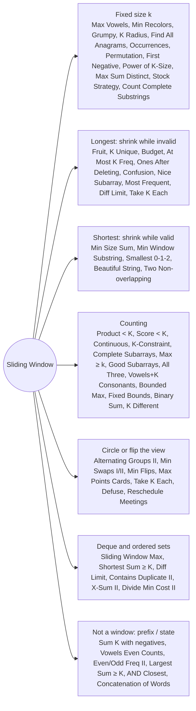

# Sliding Window: Pattern Map

> [!TIP]
> **🧠 One picture to keep**
> Picture a **caterpillar** on the array: the head `j` always crawls forward, the tail `i` only follows, so each index is touched at most twice.
> 1. **Fixed size k**: add `j`; once `j − i + 1 == k`, record, then drop `i` (Max Vowels, Anagrams, Grumpy, Cards).
> 2. **Longest valid**: add `j`; *while invalid* drop `i`; record the length (Fruit, Budget, Confusion, Frequency).
> 3. **Shortest valid**: add `j`; *while valid* record and drop `i` (Min Size Sum, Min Window Substring).
> 4. **Count**: "at most" windows add `j − i + 1`; "at least" windows add `n − j`; **exactly(k) = atMost(k) − atMost(k − 1)**.
> 5. **Helpers**: a monotonic deque gives the window max/min in O(1); TreeMap/TreeSet give order; negatives break the window, so switch to prefix sums.

**All animations:** [▶ Sliding Window Animations](https://d9-cell.github.io/java-brain/Sliding%20Window/Sliding%20Window%20Animations.html) · ⬆ [00 Brain Map](../00%20Brain%20Map.md)

## Java toolkit
| Need | Java |
|---|---|
| Letter counts | `int[26]` (or `int[128]` for any ASCII) |
| Value counts | `map.merge(x, 1, Integer::sum)`; remove the key when it hits 0 |
| Compare two count arrays | `Arrays.equals(a, b)` |
| Window max / min in O(1) | `ArrayDeque<Integer>` of indices, kept monotonic |
| Window min and max together | `TreeMap.firstKey()` / `lastKey()` |
| k smallest of the window | two `TreeSet<Integer>` ordered by (value, index) |
| Circular array | loop `j` over `2n`, read `nums[j % n]` |
| Sums / products / scores | `long` (sum × length, k·target overflow int) |

## Patterns in this folder

| # | Problem | Pattern | Mantra | Level |
|---|---|---|---|---|
| 1 | [Alternating Groups II](Alternating%20Groups%20II.md) | Fixed window, Circular | REPEAT ⇒ i = j; LENGTH k ⇒ COUNT, i++ | Medium |
| 2 | [Best Time to Buy and Sell Stock using Strategy](Best%20Time%20to%20Buy%20and%20Sell%20Stock%20using%20Strategy.md) | Fixed window | GAIN = MODIFIED − ORIGINAL IN A k WINDOW | Medium |
| 3 | [Binary Subarrays With Sum](Binary%20Subarrays%20With%20Sum.md) | Variable window, Prefix sum | DROP LEADING 0s, COUNT 1 + prefixZeros | Medium |
| 4 | [Contains Duplicate II](Contains%20Duplicate%20II.md) | Fixed window, HashSet | SET OF LAST k; add() FAILS ⇒ TRUE | Easy |
| 5 | [Continuous Subarrays](Continuous%20Subarrays.md) | Count windows, TreeMap | TREEMAP; SHRINK WHILE max − min > 2; ADD j − i + 1 | Medium |
| 6 | [Count Complete Subarrays in an Array](Count%20Complete%20Subarrays%20in%20an%20Array.md) | At least: add n − j | ALL DISTINCT INSIDE ⇒ ADD n − j, SHRINK | Medium |
| 7 | [Count Complete Substrings](Count%20Complete%20Substrings.md) | Fixed window, Split into pieces | SPLIT; FOR c: FIXED WINDOW c·k, good == c | Hard |
| 8 | [Count Occurences of Anagrams](Count%20Occurences%20of%20Anagrams.md) | Fixed window, Count array | FIXED WINDOW, COUNTS ALL ZERO | Medium |
| 9 | [Count Subarrays Where Max Element Appears at Least K Times](Count%20Subarrays%20Where%20Max%20Element%20Appears%20at%20Least%20K%20Times.md) | At least: add n − j | countMax ≥ k ⇒ ADD n − j, SHRINK | Medium |
| 10 | [Count Subarrays With Fixed Bounds](Count%20Subarrays%20With%20Fixed%20Bounds.md) | Last positions | ADD max(0, min(minPos, maxPos) − bad) | Hard |
| 11 | [Count Subarrays With Score Less Than K](Count%20Subarrays%20With%20Score%20Less%20Than%20K.md) | At most: add j − i + 1 | SHRINK WHILE sum·len ≥ k; ADD j − i + 1 | Hard |
| 12 | [Count Substrings That Satisfy K-Constraint I & II](Count%20Substrings%20That%20Satisfy%20K-Constraint%20I%20%26%20II.md) | At most: add j − i + 1, Prefix sums | SHRINK WHILE c0 > k AND c1 > k; ADD j − i + 1 | Hard |
| 13 | [Count of Substrings Containing Every Vowel and K Consonants II](Count%20of%20Substrings%20Containing%20Every%20Vowel%20and%20K%20Consonants%20II.md) | Variable window, Next index | nextCons[j] − j EXTRA ENDS PER VALID WINDOW | Medium |
| 14 | [Count the Number of Good Subarrays](Count%20the%20Number%20of%20Good%20Subarrays.md) | At least: add n − j, HashMap | pairs += copies; pairs ≥ k ⇒ ADD n − j | Medium |
| 15 | [Divide an Array Into Subarrays With Minimum Cost II](Divide%20an%20Array%20Into%20Subarrays%20With%20Minimum%20Cost%20II.md) | Fixed window, Two TreeSets | TWO TREESETS: CHOSEN (k−1 SMALLEST) + REST | Hard |
| 16 | [Find All Anagrams in a String](Find%20All%20Anagrams%20in%20a%20String.md) | Fixed window, Count array | FIXED WINDOW |p|, COUNTS ZERO ⇒ ADD i | Medium |
| 17 | [Find Subarray With Bitwise AND Closest to K](Find%20Subarray%20With%20Bitwise%20AND%20Closest%20to%20K.md) | Variable window, Bit counts | AND > k: GROW; AND < k: SHRINK (BIT COUNTS) | Hard |
| 18 | [Find Two Non-overlapping Sub-arrays Each With Target Sum](Find%20Two%20Non-overlapping%20Sub-arrays%20Each%20With%20Target%20Sum.md) | Variable window, Best so far | best[j] = SHORTEST MATCH ENDING ≤ j; PAIR WITH best[i − 1] | Medium |
| 19 | [Find X-Sum of All K-Long Subarrays II](Find%20X-Sum%20of%20All%20K-Long%20Subarrays%20II.md) | Fixed window, Two TreeSets | TOP / REST TREESETS OF (freq, value), RUNNING SUM | Hard |
| 20 | [Find the Longest Substring Containing Vowels in Even Counts](Find%20the%20Longest%20Substring%20Containing%20Vowels%20in%20Even%20Counts.md) | Prefix state, Bitmask | PARITY MASK, FIRST INDEX PER MASK | Medium |
| 21 | [Find the Power of K-Size Subarrays I](Find%20the%20Power%20of%20K-Size%20Subarrays%20I.md) | Fixed window, Run length | RUN ≥ k ⇒ nums[j], ELSE −1 | Medium |
| 22 | [First negative integer in every window of size k](First%20negative%20integer%20in%20every%20window%20of%20size%20k.md) | Fixed window, Queue | QUEUE OF NEGATIVES; FRONT LEAVES WITH A[i] | Medium |
| 23 | [Frequency of the Most Frequent Element](Frequency%20of%20the%20Most%20Frequent%20Element.md) | Sort + variable window | SORT; SHRINK WHILE len·nums[j] − sum > k | Medium |
| 24 | [Fruit Into Baskets](Fruit%20Into%20Baskets.md) | Longest window, HashMap | AT MOST 2 TYPES; LONGEST WINDOW | Medium |
| 25 | [Get Equal Substrings Within Budget](Get%20Equal%20Substrings%20Within%20Budget.md) | Longest window | cost[i] = |s[i] − t[i]|; LONGEST SUM ≤ maxCost | Medium |
| 26 | [Grumpy Bookstore Owner](Grumpy%20Bookstore%20Owner.md) | Fixed window | BASE HAPPY + MAX WINDOW OF customers·grumpy | Medium |
| 27 | [K Radius Subarray Averages](K%20Radius%20Subarray%20Averages.md) | Fixed window | FIXED WINDOW 2k+1, WRITE AT CENTRE | Medium |
| 28 | [Largest Sum Subarray of Size at least K](Largest%20Sum%20Subarray%20of%20Size%20at%20least%20K.md) | Variable window, Kadane | TRAIL < 0 ⇒ CUT IT OFF | Medium |
| 29 | [Length of Longest Subarray With at Most K Frequency](Length%20of%20Longest%20Subarray%20With%20at%20Most%20K%20Frequency.md) | Longest window, HashMap | SHRINK WHILE count(nums[j]) > k | Medium |
| 30 | [Longest Continuous Subarray With Absolute Diff Less Than or Equal to Limit](Longest%20Continuous%20Subarray%20With%20Absolute%20Diff%20Less%20Than%20or%20Equal%20to%20Limit.md) | Longest window, Monotonic deque | MAX DEQUE − MIN DEQUE > limit ⇒ SHRINK | Medium |
| 31 | [Longest K unique characters substring](Longest%20K%20unique%20characters%20substring.md) | Longest window, HashMap | EXACTLY k ⇒ RECORD; > k ⇒ SHRINK | Medium |
| 32 | [Longest Nice Subarray](Longest%20Nice%20Subarray.md) | Longest window, Bitmask | mask & x ≠ 0 ⇒ mask ^= nums[i++] | Medium |
| 33 | [Longest Sub-Array with Sum K](Longest%20Sub-Array%20with%20Sum%20K.md) | Prefix sum, HashMap | FIRST INDEX OF EACH PREFIX; i − first[sum − K] | Medium |
| 34 | [Longest Subarray of 1's After Deleting One Element](Longest%20Subarray%20of%201%27s%20After%20Deleting%20One%20Element.md) | Longest window | NEW ZERO ⇒ i = lastZero + 1; ANSWER j − i | Medium |
| 35 | [Maximize the Confusion of an Exam](Maximize%20the%20Confusion%20of%20an%20Exam.md) | Longest window | SHRINK WHILE min(T, F) > k | Medium |
| 36 | [Maximum Difference Between Even and Odd Frequency II](Maximum%20Difference%20Between%20Even%20and%20Odd%20Frequency%20II.md) | Prefix state, Parity | FOR (a, b): minPrev[state ^ 2] | Hard |
| 37 | [Maximum Number of Vowels in a Substring of Given Length](Maximum%20Number%20of%20Vowels%20in%20a%20Substring%20of%20Given%20Length.md) | Fixed window | ADD, RECORD AT k, REMOVE | Medium |
| 38 | [Maximum Points You Can Obtain from Cards](Maximum%20Points%20You%20Can%20Obtain%20from%20Cards.md) | Fixed window, Flip the view | TOTAL − MIN WINDOW OF n − k | Medium |
| 39 | [Maximum Sum of Distinct Subarrays With Length K](Maximum%20Sum%20of%20Distinct%20Subarrays%20With%20Length%20K.md) | Fixed window, HashSet | EVICT UNTIL nums[j] NOT IN SET | Medium |
| 40 | [Minimum Number of Flips to Make the Binary String Alternating](Minimum%20Number%20of%20Flips%20to%20Make%20the%20Binary%20String%20Alternating.md) | Fixed window, Circular | WINDOW n OVER 2n, COMPARE 0101 AND 1010 | Medium |
| 41 | [Minimum Size Subarray Sum](Minimum%20Size%20Subarray%20Sum.md) | Shortest window | WHILE sum ≥ target: RECORD, SHRINK | Medium |
| 42 | [Minimum Swaps to Group All 1's Together II](Minimum%20Swaps%20to%20Group%20All%201%27s%20Together%20II.md) | Fixed window, Circular | WINDOW OF total-ones OVER 2n; ANSWER ones − best | Medium |
| 43 | [Minimum Swaps to Group All 1's Together](Minimum%20Swaps%20to%20Group%20All%201%27s%20Together.md) | Fixed window | MIN ZEROS IN A WINDOW OF SIZE ones | Medium |
| 44 | [Minimum Window Substring](Minimum%20Window%20Substring.md) | Shortest window, Count array | required == 0 ⇒ RECORD, SHRINK | Hard |
| 45 | [Number of Subarrays with Bounded Maximum](Number%20of%20Subarrays%20with%20Bounded%20Maximum.md) | Counting | IN RANGE: prev = j − i + 1; SMALL: + prev; BIG: RESET | Medium |
| 46 | [Number of Substrings Containing All Three Characters](Number%20of%20Substrings%20Containing%20All%20Three%20Characters.md) | At least: add n − j | HAS a, b, c ⇒ ADD n − j, SHRINK | Medium |
| 47 | [Permutation in String](Permutation%20in%20String.md) | Fixed window, Count array | FIXED WINDOW |s1|, EQUAL COUNTS ⇒ TRUE | Medium |
| 48 | [Reschedule Meetings for Maximum Free Time I](Reschedule%20Meetings%20for%20Maximum%20Free%20Time%20I.md) | Fixed window, Gaps | MAX SUM OF k + 1 CONSECUTIVE GAPS | Medium |
| 49 | [Shortest Subarray with Sum at Least K](Shortest%20Subarray%20with%20Sum%20at%20Least%20K.md) | Monotonic deque, Prefix sum | POP FRONT WHILE pre[j] − pre[front] ≥ K; KEEP DEQUE INCREASING | Hard |
| 50 | [Shortest and Lexicographically Smallest Beautiful String](Shortest%20and%20Lexicographically%20Smallest%20Beautiful%20String.md) | Shortest window | WINDOW ≤ k ONES, NO LEADING 0; COMPARE LENGTH THEN LEX | Medium |
| 51 | [Sliding Window Maximum](Sliding%20Window%20Maximum.md) | Monotonic deque | DEQUE DECREASING; FRONT = MAX; EVICT EXPIRED | Hard |
| 52 | [Smallest window containing 0, 1 and 2](Smallest%20window%20containing%200%2C%201%20and%202.md) | Shortest window | HAS 0, 1, 2 ⇒ RECORD, SHRINK | Easy |
| 53 | [Subarray Product Less Than K](Subarray%20Product%20Less%20Than%20K.md) | At most: add j − i + 1 | DIVIDE OUT WHILE prod ≥ k; ADD right − left + 1 | Medium |
| 54 | [Subarrays with K Different Integers](Subarrays%20with%20K%20Different%20Integers.md) | Exactly = atMost − atMost | atMost(k) − atMost(k − 1) | Hard |
| 55 | [Substring with Concatenation of All Words](Substring%20with%20Concatenation%20of%20All%20Words.md) | Window over words | w OFFSETS × WINDOW OVER WORDS | Hard |
| 56 | [Take K of Each Character From Left and Right](Take%20K%20of%20Each%20Character%20From%20Left%20and%20Right.md) | Longest window, Flip the view | LONGEST KEPT WINDOW WITH OUTSIDE ≥ k EACH | Medium |
| 57 | [Defuse the Bomb](Defuse%20the%20Bomb.md) | Fixed window, Circular | START [1..k] OR [n+k..n−1], SLIDE BOTH ENDS | Easy |
| 58 | [Minimum Recolors to Get K Consecutive Black Blocks](Minimum%20Recolors%20to%20Get%20K%20Consecutive%20Black%20Blocks.md) | Fixed window | FIXED WINDOW, MIN WHITE COUNT | Easy |

## Suggested learning order
1. Fixed window: [Maximum Number of Vowels in a Substring of Given Length](Maximum%20Number%20of%20Vowels%20in%20a%20Substring%20of%20Given%20Length.md) ⭐, [Minimum Recolors to Get K Consecutive Black Blocks](Minimum%20Recolors%20to%20Get%20K%20Consecutive%20Black%20Blocks.md), [Grumpy Bookstore Owner](Grumpy%20Bookstore%20Owner.md), [K Radius Subarray Averages](K%20Radius%20Subarray%20Averages.md), [Find All Anagrams in a String](Find%20All%20Anagrams%20in%20a%20String.md) ⭐, [Permutation in String](Permutation%20in%20String.md)
2. Longest (shrink while invalid): [Fruit Into Baskets](Fruit%20Into%20Baskets.md) ⭐, [Longest K unique characters substring](Longest%20K%20unique%20characters%20substring.md), [Get Equal Substrings Within Budget](Get%20Equal%20Substrings%20Within%20Budget.md), [Longest Subarray of 1's After Deleting One Element](Longest%20Subarray%20of%201%27s%20After%20Deleting%20One%20Element.md), [Maximize the Confusion of an Exam](Maximize%20the%20Confusion%20of%20an%20Exam.md), [Frequency of the Most Frequent Element](Frequency%20of%20the%20Most%20Frequent%20Element.md) ⭐
3. Shortest (shrink while valid): [Minimum Size Subarray Sum](Minimum%20Size%20Subarray%20Sum.md) ⭐, [Minimum Window Substring](Minimum%20Window%20Substring.md) ⭐, [Smallest window containing 0, 1 and 2](Smallest%20window%20containing%200%2C%201%20and%202.md)
4. Counting: [Subarray Product Less Than K](Subarray%20Product%20Less%20Than%20K.md) ⭐, [Number of Substrings Containing All Three Characters](Number%20of%20Substrings%20Containing%20All%20Three%20Characters.md), [Count Subarrays Where Max Element Appears at Least K Times](Count%20Subarrays%20Where%20Max%20Element%20Appears%20at%20Least%20K%20Times.md), [Subarrays with K Different Integers](Subarrays%20with%20K%20Different%20Integers.md) ⭐, [Binary Subarrays With Sum](Binary%20Subarrays%20With%20Sum.md), [Count Subarrays With Fixed Bounds](Count%20Subarrays%20With%20Fixed%20Bounds.md)
5. Flip the view / circles: [Maximum Points You Can Obtain from Cards](Maximum%20Points%20You%20Can%20Obtain%20from%20Cards.md) ⭐, [Take K of Each Character From Left and Right](Take%20K%20of%20Each%20Character%20From%20Left%20and%20Right.md), [Minimum Swaps to Group All 1's Together II](Minimum%20Swaps%20to%20Group%20All%201%27s%20Together%20II.md), [Minimum Number of Flips to Make the Binary String Alternating](Minimum%20Number%20of%20Flips%20to%20Make%20the%20Binary%20String%20Alternating.md)
6. Deques and sets: [Sliding Window Maximum](Sliding%20Window%20Maximum.md) ⭐, [Longest Continuous Subarray With Absolute Diff Less Than or Equal to Limit](Longest%20Continuous%20Subarray%20With%20Absolute%20Diff%20Less%20Than%20or%20Equal%20to%20Limit.md), [Shortest Subarray with Sum at Least K](Shortest%20Subarray%20with%20Sum%20at%20Least%20K.md) ⭐, [Find X-Sum of All K-Long Subarrays II](Find%20X-Sum%20of%20All%20K-Long%20Subarrays%20II.md), [Divide an Array Into Subarrays With Minimum Cost II](Divide%20an%20Array%20Into%20Subarrays%20With%20Minimum%20Cost%20II.md)
7. When a window does not work: [Longest Sub-Array with Sum K](Longest%20Sub-Array%20with%20Sum%20K.md), [Find the Longest Substring Containing Vowels in Even Counts](Find%20the%20Longest%20Substring%20Containing%20Vowels%20in%20Even%20Counts.md), [Maximum Difference Between Even and Odd Frequency II](Maximum%20Difference%20Between%20Even%20and%20Odd%20Frequency%20II.md)

## Connections to other folders
- TreeSet window on values: [Contains Duplicate III](../HashSet/Contains%20Duplicate%20III.md) (HashSet)
- Heap versions: [Find X-Sum of All K-Long Subarrays I](../Heap/Find%20X-Sum%20of%20All%20K-Long%20Subarrays%20I.md), [Constrained Subsequence Sum](../Heap/Constrained%20Subsequence%20Sum.md) (Heap)
- OR window with bit counts: [Shortest Subarray With OR at Least K II](../Bit_Magic/Shortest%20Subarray%20With%20OR%20at%20Least%20K%20II.md) (Bit Magic)
- Monotonic stack cousins: [Stack](../Stack/Stack%20-%20Pattern%20Map.md)
- Deque basics: [Queue](../Queue/Queue%20-%20Pattern%20Map.md)
- Prefix sum + map counting: [HashMap](../HashMap/HashMap%20-%20Pattern%20Map.md)
