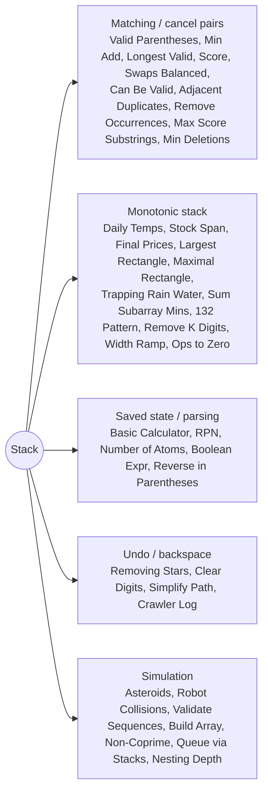

# Stack: Pattern Map

> [!TIP]
> **🧠 One picture to keep**
> A stack holds **unfinished business** — the most recent thing is resolved first.
> Four families:
> 1. **Matching** (brackets, cancel pairs): push openers, pop on closers.
> 2. **Monotonic stack** (next greater / smaller): items wait on the stack until someone bigger/smaller arrives and answers them. Each item is pushed and popped once → O(n).
> 3. **Saved state** (calculators, nested formulas): `(` pushes the outer context, `)` folds the inner result back.
> 4. **Undo / backspace** (stars, digits, `..` in paths): the newest item is the one removed.

**All animations:** [▶ Stack Animations](https://d9-cell.github.io/java-brain/Stack/Stack%20Animations.html) · ⬆ [00 Brain Map](../00%20Brain%20Map.md)

## Java toolkit
| Need | Java |
|---|---|
| Stack | `Deque<Integer> st = new ArrayDeque<>();` `push / pop / peek` (never `java.util.Stack`) |
| Stack of chars as a string | `StringBuilder`: `append`, `deleteCharAt(len - 1)`, `charAt(len - 1)` |
| Store indices, not values | distances/widths need positions: `res[j] = i - j` |
| Next greater element | `while (!st.isEmpty() && a[st.peek()] < a[i]) answer(st.pop());` |
| Previous smaller (strict) vs next smaller-or-equal | pop with `>` on one side, `>=` on the other to avoid double counting |
| Sentinel | process an extra value (`0` height) at the end to flush the stack |

## Patterns in this folder

| # | Problem | Pattern | Mantra | Level |
|---|---|---|---|---|
| 1 | [132 Pattern](132%20Pattern.md) | Monotonic stack | RIGHT→LEFT, POPPED = BEST "2", a[i] < two → FOUND | Medium |
| 2 | [Asteroid Collision](Asteroid%20Collision.md) | Stack simulation | ONLY → ← COLLIDE, BIGGER SURVIVES | Medium |
| 3 | [Basic Calculator](Basic%20Calculator.md) | Saved state | result + sign; "(" SAVES, ")" FOLDS | Hard |
| 4 | [Build an Array With Stack Operations](Build%20an%20Array%20With%20Stack%20Operations.md) | Simulation | PUSH ALL, POP UNWANTED | Medium |
| 5 | [Check if a Parentheses String Can Be Valid](Check%20if%20a%20Parentheses%20String%20Can%20Be%20Valid.md) | Matching with wildcards | TWO SWEEPS WITH JOKERS | Medium |
| 6 | [Daily Temperatures](Daily%20Temperatures.md) | Monotonic stack (next greater) | DECREASING STACK OF INDICES | Medium |
| 7 | [Clear Digits](Clear%20Digits.md) | Undo stack | LETTER PUSH, DIGIT POP | Easy |
| 8 | [Crawler Log Folder](Crawler%20Log%20Folder.md) | Stack size only | DEPTH COUNTER | Easy |
| 9 | [Maximum Nesting Depth of the Parentheses](Maximum%20Nesting%20Depth%20of%20the%20Parentheses.md) | Counter | COUNTER, MAX | Easy |
| 10 | [Evaluate Reverse Polish Notation](Evaluate%20Reverse%20Polish%20Notation.md) | Operand stack | NUMBERS PUSH, OP POPS b THEN a | Medium |
| 11 | [Implement Queue using Stacks](Implement%20Queue%20using%20Stacks.md) | Two stacks | IN FOR PUSH, OUT FOR POP, POUR WHEN EMPTY | Easy |
| 12 | [Largest Rectangle in Histogram](Largest%20Rectangle%20in%20Histogram.md) | Monotonic stack (NSL/NSR) | INCREASING STACK, POP → AREA WITH NSL/NSR | Hard |
| 13 | [Longest Valid Parentheses](Longest%20Valid%20Parentheses.md) | Index stack with base | STACK OF INDICES, BASE −1, LENGTH = i − TOP | Hard |
| 14 | [Maximal Rectangle](Maximal%20Rectangle.md) | Histogram per row | ROW HISTOGRAMS + LARGEST RECTANGLE | Hard |
| 15 | [Maximum Score From Removing Substrings](Maximum%20Score%20From%20Removing%20Substrings.md) | Greedy + stack | GREEDY: HIGH PAIR FIRST, STACK REMOVAL | Medium |
| 16 | [Minimum Add to Make Parentheses Valid](Minimum%20Add%20to%20Make%20Parentheses%20Valid.md) | Matching counter | UNMATCHED ( + UNMATCHED ) | Medium |
| 17 | [Minimum Deletions to Make String Balanced](Minimum%20Deletions%20to%20Make%20String%20Balanced.md) | Split point, Stack | TRY EVERY SPLIT | Medium |
| 18 | [Minimum Number of Swaps to Make the String Balanced](Minimum%20Number%20of%20Swaps%20to%20Make%20the%20String%20Balanced.md) | Matching counter | CANCEL PAIRS, ceil(u / 2) | Medium |
| 19 | [Final Prices With a Special Discount in a Shop](Final%20Prices%20With%20a%20Special%20Discount%20in%20a%20Shop.md) | Monotonic stack (next smaller-or-equal) | NEXT SMALLER-OR-EQUAL STACK | Easy |
| 20 | [Maximum Width Ramp](Maximum%20Width%20Ramp.md) | Monotonic stack | PREFIX-MIN STACK, SWEEP j BACKWARDS | Medium |
| 21 | [Minimum Operations to Convert All Elements to Zero](Minimum%20Operations%20to%20Convert%20All%20Elements%20to%20Zero.md) | Monotonic stack | INCREASING STACK, NEW LEVEL = +1 OP | Medium |
| 22 | [Number of Atoms](Number%20of%20Atoms.md) | Saved state (stack of maps) | STACK OF MAPS, ")k" MULTIPLIES AND MERGES | Hard |
| 23 | [Online Stock Span](Online%20Stock%20Span.md) | Monotonic stack (previous greater) | (price, span) STACK, SWALLOW ≤ | Medium |
| 24 | [Parsing A Boolean Expression](Parsing%20A%20Boolean%20Expression.md) | Saved state | PUSH, ON ")" COLLECT AND APPLY | Hard |
| 25 | [Remove All Adjacent Duplicates In String](Remove%20All%20Adjacent%20Duplicates%20In%20String.md) | Cancel pairs | EQUAL TO TOP → POP | Easy |
| 26 | [Remove All Occurrences of a Substring](Remove%20All%20Occurrences%20of%20a%20Substring.md) | Stack with suffix check | PUSH, TAIL == part → CUT | Medium |
| 27 | [Remove K Digits](Remove%20K%20Digits.md) | Monotonic stack (greedy) | INCREASING STACK, POP BIGGER WHILE k | Medium |
| 28 | [Removing Stars From a String](Removing%20Stars%20From%20a%20String.md) | Undo stack | LETTER PUSH, STAR POP | Medium |
| 29 | [Replace Non-Coprime Numbers in Array](Replace%20Non-Coprime%20Numbers%20in%20Array.md) | Stack merging | STACK, MERGE WITH LCM WHILE gcd > 1 | Hard |
| 30 | [Reverse Substrings Between Each Pair of Parentheses](Reverse%20Substrings%20Between%20Each%20Pair%20of%20Parentheses.md) | Bracket pairing (wormholes) | PAIR BRACKETS, WALK + JUMP + FLIP | Medium |
| 31 | [Robot Collisions](Robot%20Collisions.md) | Stack simulation | SORT, STACK OF R, FIGHT WITH HEALTH | Hard |
| 32 | [Score of Parentheses](Score%20of%20Parentheses.md) | Depth counting | CORE AT DEPTH d → 2^d | Medium |
| 33 | [Simplify Path](Simplify%20Path.md) | Undo stack | SPLIT "/", NAME PUSH, ".." POP | Medium |
| 34 | [Sum of Subarray Minimums](Sum%20of%20Subarray%20Minimums.md) | Monotonic stack (contribution) | PREV SMALLER × NEXT SMALLER-OR-EQUAL | Medium |
| 35 | [Trapping Rain Water (using stack)](Trapping%20Rain%20Water%20%28using%20stack%29.md) | Monotonic stack | DECREASING STACK, FILL HORIZONTAL LAYERS | Hard |
| 36 | [Validate Stack Sequences](Validate%20Stack%20Sequences.md) | Stack simulation | PUSH, POP WHILE TOP == NEXT | Medium |
| 37 | [Valid Parentheses](Valid%20Parentheses.md) | Matching | PUSH EXPECTED CLOSER, MATCH ON CLOSE | Easy |

## Suggested learning order
1. Matching: [Valid Parentheses](Valid%20Parentheses.md) ⭐, [Minimum Add to Make Parentheses Valid](Minimum%20Add%20to%20Make%20Parentheses%20Valid.md), [Remove All Adjacent Duplicates In String](Remove%20All%20Adjacent%20Duplicates%20In%20String.md), [Removing Stars From a String](Removing%20Stars%20From%20a%20String.md)
2. Monotonic: [Daily Temperatures](Daily%20Temperatures.md) ⭐, [Final Prices With a Special Discount in a Shop](Final%20Prices%20With%20a%20Special%20Discount%20in%20a%20Shop.md), [Online Stock Span](Online%20Stock%20Span.md), [Largest Rectangle in Histogram](Largest%20Rectangle%20in%20Histogram.md) ⭐, [Maximal Rectangle](Maximal%20Rectangle.md), [Trapping Rain Water (using stack)](Trapping%20Rain%20Water%20%28using%20stack%29.md), [Sum of Subarray Minimums](Sum%20of%20Subarray%20Minimums.md)
3. Monotonic tricks: [Remove K Digits](Remove%20K%20Digits.md), [132 Pattern](132%20Pattern.md), [Maximum Width Ramp](Maximum%20Width%20Ramp.md), [Minimum Operations to Convert All Elements to Zero](Minimum%20Operations%20to%20Convert%20All%20Elements%20to%20Zero.md)
4. Parsing: [Evaluate Reverse Polish Notation](Evaluate%20Reverse%20Polish%20Notation.md), [Basic Calculator](Basic%20Calculator.md) ⭐, [Number of Atoms](Number%20of%20Atoms.md), [Parsing A Boolean Expression](Parsing%20A%20Boolean%20Expression.md), [Reverse Substrings Between Each Pair of Parentheses](Reverse%20Substrings%20Between%20Each%20Pair%20of%20Parentheses.md)
5. Simulation: [Asteroid Collision](Asteroid%20Collision.md), [Robot Collisions](Robot%20Collisions.md), [Validate Stack Sequences](Validate%20Stack%20Sequences.md), [Implement Queue using Stacks](Implement%20Queue%20using%20Stacks.md)
6. The rest: [Longest Valid Parentheses](Longest%20Valid%20Parentheses.md), [Score of Parentheses](Score%20of%20Parentheses.md), [Check if a Parentheses String Can Be Valid](Check%20if%20a%20Parentheses%20String%20Can%20Be%20Valid.md), [Minimum Number of Swaps to Make the String Balanced](Minimum%20Number%20of%20Swaps%20to%20Make%20the%20String%20Balanced.md), [Minimum Deletions to Make String Balanced](Minimum%20Deletions%20to%20Make%20String%20Balanced.md), [Maximum Score From Removing Substrings](Maximum%20Score%20From%20Removing%20Substrings.md), [Remove All Occurrences of a Substring](Remove%20All%20Occurrences%20of%20a%20Substring.md), [Replace Non-Coprime Numbers in Array](Replace%20Non-Coprime%20Numbers%20in%20Array.md), [Simplify Path](Simplify%20Path.md), [Build an Array With Stack Operations](Build%20an%20Array%20With%20Stack%20Operations.md), [Clear Digits](Clear%20Digits.md), [Crawler Log Folder](Crawler%20Log%20Folder.md), [Maximum Nesting Depth of the Parentheses](Maximum%20Nesting%20Depth%20of%20the%20Parentheses.md)

## Connections to other folders
- Stack ↔ Queue conversions: [Implement Stack using Queues](../Design/Implement%20Stack%20using%20Queues.md) (Design) and [Reverse First K elements of Queue](../Queue/Reverse%20First%20K%20elements%20of%20Queue.md)
- Monotonic DEQUE (sliding window max): [Sliding Window Maximum](../Sliding%20Window/Sliding%20Window%20Maximum.md)
- 2-D rain water with a heap: [Trapping Rain Water II](../Heap/Trapping%20Rain%20Water%20II.md)
- Lexicographic "remove to make smallest": also Remove Duplicate Letters (Greedy)
