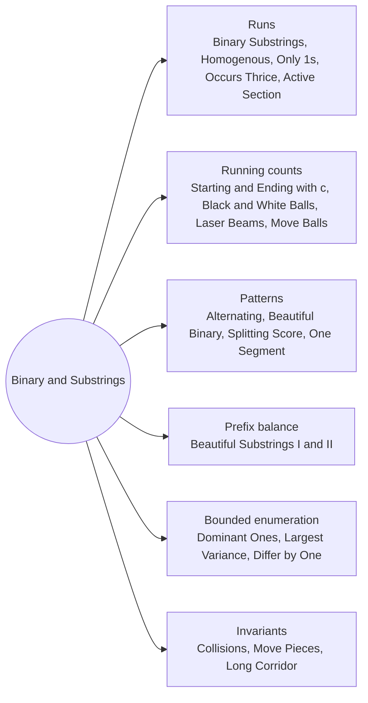

# Binary Strings and Substring Counting: Pattern Map

> [!TIP]
> **🧠 One picture to keep**
> Counting substrings is counting **(start, end) pairs**. Group the string into **runs**, carry a **running count**, or use a **prefix balance** with a hash map.
> 1. **Runs**: a run of length L holds L(L+1)/2 substrings; neighbour runs pair up (Binary Substrings, Homogenous, Only 1s, Thrice, Active Section).
> 2. **Running counts**: each new character pairs with everything counted so far (Starting and Ending with c, Black and White Balls, Laser Beams, Move Balls).
> 3. **Patterns and pairs**: compare with 0101…, fix pairs, prefix vs suffix (Alternating, Beautiful Binary, Splitting Score, One Segment).
> 4. **Prefix balance + hash map**: equal vowels and consonants with a residue (Beautiful Substrings I and II).
> 5. **Bounded enumeration**: few zeros, few letters, Kadane per letter pair (Dominant Ones, Largest Variance, Differ by One).
> 6. **Invariants**: what never crosses what (Collisions on a Road, Move Pieces, Long Corridor).

**All animations:** [▶ Binary Strings and Substring Counting Animations](https://d9-cell.github.io/java-brain/Strings/Binary%20Strings%20and%20Substring%20Counting/Binary%20Strings%20and%20Substring%20Counting%20Animations.html) · ⬆ [00 Brain Map](../../00%20Brain%20Map.md)

## Java toolkit
| Need | Java |
|---|---|
| Run length at i | `run = s.charAt(i) == s.charAt(i - 1) ? run + 1 : 1;` |
| Substrings in a run | `(long) L * (L + 1) / 2` |
| Pairs among k items | `(long) k * (k - 1) / 2` |
| Prefix balance count | `count += seen.getOrDefault(bal, 0); seen.merge(bal, 1, Integer::sum);` |
| Contains a pattern | `s.contains("01")` |
| Modular sum | `total = (total + x) % MOD` with long |

## Patterns in this folder

| # | Problem | Pattern | Mantra | Level |
|---|---|---|---|---|
| 1 | [Count Binary Substrings](Count%20Binary%20Substrings.md) | Runs | run lengths · Σ min(prev, cur) | Easy |
| 2 | [Count Number of Homogenous Substrings](Count%20Number%20of%20Homogenous%20Substrings.md) | Runs, Running count | run = same ? run + 1 : 1 · total += run | Medium |
| 3 | [Number of Substrings With Only 1s](Number%20of%20Substrings%20With%20Only%201s.md) | Runs, Running count | run = c == '1' ? run + 1 : 0 · total += run | Medium |
| 4 | [Count Substrings Starting and Ending with Given Character](Count%20Substrings%20Starting%20and%20Ending%20with%20Given%20Character.md) | Pair counting | k = count(c) · k(k+1)/2 | Medium |
| 5 | [Check if Binary String Has at Most One Segment of Ones](Check%20if%20Binary%20String%20Has%20at%20Most%20One%20Segment%20of%20Ones.md) | Pattern check | RETURN !s.contains("01") | Easy |
| 6 | [Minimum Changes To Make Alternating Binary String](Minimum%20Changes%20To%20Make%20Alternating%20Binary%20String.md) | Compare with a pattern | d = #(s[i] != i % 2) · min(d, n − d) | Easy |
| 7 | [Minimum Number of Changes to Make Binary String Beautiful](Minimum%20Number%20of%20Changes%20to%20Make%20Binary%20String%20Beautiful.md) | Fixed pairs | FOR i += 2: s[i] != s[i+1] → changes++ | Medium |
| 8 | [Maximum Score After Splitting a String](Maximum%20Score%20After%20Splitting%20a%20String.md) | Prefix balance | ones total · balance += (0 → +1, 1 → −1) · ones + max balance | Easy |
| 9 | [Separate Black and White Balls](Separate%20Black%20and%20White%20Balls.md) | Running count | c == '1' → ones++ · c == '0' → steps += ones | Medium |
| 10 | [Count Collisions on a Road](Count%20Collisions%20on%20a%20Road.md) | Invariant | trim leading L and trailing R · count non-S in the middle | Medium |
| 11 | [Number of Laser Beams in a Bank](Number%20of%20Laser%20Beams%20in%20a%20Bank.md) | Running count | cur = devices in row · cur > 0 → total += prev · cur, prev = cur | Medium |
| 12 | [Number of Ways to Divide a Long Corridor](Number%20of%20Ways%20to%20Divide%20a%20Long%20Corridor.md) | Product of gaps | at seat 3, 5, 7…: ways *= i − lastSeat · odd or < 2 seats → 0 | Hard |
| 13 | [Minimum Number of Operations to Move All Balls to Each Box](Minimum%20Number%20of%20Operations%20to%20Move%20All%20Balls%20to%20Each%20Box.md) | Prefix cost | ans[i] += cost · balls += box · cost += balls (both directions) | Medium |
| 14 | [Count the Number of Substrings With Dominant Ones](Count%20the%20Number%20of%20Substrings%20With%20Dominant%20Ones.md) | Bounded enumeration | FOR start: z = 0 → all ends before next zero · z ≥ 1: ends in [z-th zero, next zero) with length ≥ z² + z | Medium |
| 15 | [Count Beautiful Substrings I](Count%20Beautiful%20Substrings%20I.md) | Enumerate substrings | FOR i: FOR j ≥ i: update v, c · v == c && v·c % k == 0 → count | Medium |
| 16 | [Count Beautiful Substrings II](Count%20Beautiful%20Substrings%20II.md) | Prefix balance, Residue | m = min m: m² % k == 0 · key = (balance, vowels % m) · count += seen[key] | Hard |
| 17 | [Maximize Active Section with Trade I](Maximize%20Active%20Section%20with%20Trade%20I.md) | Runs | ones + max over adjacent zero blocks (z₁ + z₂) | Medium |
| 18 | [Count Substrings That Differ by One Character](Count%20Substrings%20That%20Differ%20by%20One%20Character.md) | Enumerate alignments | FOR i, j: extend k · diff == 1 → count · diff > 1 → stop | Medium |
| 19 | [Substring With Largest Variance](Substring%20With%20Largest%20Variance.md) | Kadane per letter pair | FOR a ≠ b: countA, countB · countB > 0 → best · countA < countB && b remains → reset | Hard |
| 20 | [Find Longest Special Substring That Occurs Thrice](Find%20Longest%20Special%20Substring%20That%20Occurs%20Thrice.md) | Runs, Top three | top3 runs per letter · max(t0−2, min(t0−1, t1), t2) · none → −1 | Medium |
| 21 | [Move Pieces to Obtain a String](Move%20Pieces%20to%20Obtain%20a%20String.md) | Invariant, Two pointers | skip _ on both · same piece · L: i ≥ j · R: i ≤ j | Medium |

## Suggested learning order
1. [Check if Binary String Has at Most One Segment of Ones](Check%20if%20Binary%20String%20Has%20at%20Most%20One%20Segment%20of%20Ones.md), [Count Substrings Starting and Ending with Given Character](Count%20Substrings%20Starting%20and%20Ending%20with%20Given%20Character.md), [Number of Substrings With Only 1s](Number%20of%20Substrings%20With%20Only%201s.md), [Count Number of Homogenous Substrings](Count%20Number%20of%20Homogenous%20Substrings.md)
2. [Count Binary Substrings](Count%20Binary%20Substrings.md) ⭐, [Minimum Changes To Make Alternating Binary String](Minimum%20Changes%20To%20Make%20Alternating%20Binary%20String.md), [Minimum Number of Changes to Make Binary String Beautiful](Minimum%20Number%20of%20Changes%20to%20Make%20Binary%20String%20Beautiful.md), [Maximum Score After Splitting a String](Maximum%20Score%20After%20Splitting%20a%20String.md)
3. [Separate Black and White Balls](Separate%20Black%20and%20White%20Balls.md), [Number of Laser Beams in a Bank](Number%20of%20Laser%20Beams%20in%20a%20Bank.md), [Minimum Number of Operations to Move All Balls to Each Box](Minimum%20Number%20of%20Operations%20to%20Move%20All%20Balls%20to%20Each%20Box.md) ⭐
4. [Count Collisions on a Road](Count%20Collisions%20on%20a%20Road.md), [Move Pieces to Obtain a String](Move%20Pieces%20to%20Obtain%20a%20String.md), [Number of Ways to Divide a Long Corridor](Number%20of%20Ways%20to%20Divide%20a%20Long%20Corridor.md), [Maximize Active Section with Trade I](Maximize%20Active%20Section%20with%20Trade%20I.md)
5. [Find Longest Special Substring That Occurs Thrice](Find%20Longest%20Special%20Substring%20That%20Occurs%20Thrice.md), [Count Beautiful Substrings I](Count%20Beautiful%20Substrings%20I.md), [Count Beautiful Substrings II](Count%20Beautiful%20Substrings%20II.md) ⭐
6. [Count Substrings That Differ by One Character](Count%20Substrings%20That%20Differ%20by%20One%20Character.md), [Substring With Largest Variance](Substring%20With%20Largest%20Variance.md), [Count the Number of Substrings With Dominant Ones](Count%20the%20Number%20of%20Substrings%20With%20Dominant%20Ones.md)

## Connections to other folders
- [Sliding Window - Pattern Map](../../Sliding%20Window/Sliding%20Window%20-%20Pattern%20Map.md) for windows with constraints
- [HashMap - Pattern Map](../../HashMap/HashMap%20-%20Pattern%20Map.md) for prefix sums with a map
- [Stock and Kadane States - Pattern Map](../../DP/Stock%20and%20Kadane%20States/Stock%20and%20Kadane%20States%20-%20Pattern%20Map.md) for Kadane
