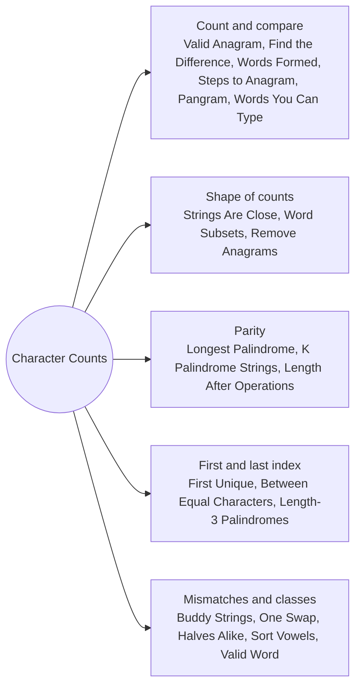

# Character Counts and Anagrams: Pattern Map

> [!TIP]
> **🧠 One picture to keep**
> When order does not matter, a string is just **26 counters**. Build them once, then compare, subtract or scan them.
> 1. **Count and compare**: anagrams, letters you can spend, letters left over (Valid Anagram, Find the Difference, Words Formed by Characters, Steps to Anagram).
> 2. **Shape of the counts**: same letter set and same sorted frequencies (Strings Are Close, Word Subsets, Remove Anagrams).
> 3. **Parity of counts**: pairs build palindromes, odd counts sit in the middle (Longest Palindrome, K Palindrome Strings, Length After Operations).
> 4. **First and last position**: first index per letter, last index per letter (First Unique, Largest Substring Between Equal, Length-3 Palindromic Subsequences).
> 5. **Mismatch positions**: at most two positions may differ (Buddy Strings, One Swap).

**All animations:** [▶ Character Counts and Anagrams Animations](https://d9-cell.github.io/java-brain/Strings/Character%20Counts%20and%20Anagrams/Character%20Counts%20and%20Anagrams%20Animations.html) · ⬆ [00 Brain Map](../../00%20Brain%20Map.md)

## Java toolkit
| Need | Java |
|---|---|
| Letter counts | `int[] cnt = new int[26]; cnt[c - 'a']++;` |
| Any ASCII | `int[] cnt = new int[128]; cnt[c]++;` |
| Letter set as bits | `mask |= 1 << (c - 'a');` all letters → `(1 << 26) - 1` |
| Sorted key for anagrams | `char[] a = s.toCharArray(); Arrays.sort(a); new String(a)` |
| Compare count arrays | `Arrays.equals(a, b)` |
| First index per letter | `int[] first = new int[26]; Arrays.fill(first, -1);` |

## Patterns in this folder

| # | Problem | Pattern | Mantra | Level |
|---|---|---|---|---|
| 1 | [Valid Anagram](Valid%20Anagram.md) | Count and compare | cnt[s[i]]++, cnt[t[i]]−− · ALL zero | Easy |
| 2 | [Find the Difference](Find%20the%20Difference.md) | XOR cancel | x ^= every char of s and t · RETURN (char) x | Easy |
| 3 | [First Unique Character in a String](First%20Unique%20Character%20in%20a%20String.md) | Count then scan | count · FOR i: cnt[s[i]] == 1 → i | Easy |
| 4 | [Find Words That Can Be Formed by Characters](Find%20Words%20That%20Can%20Be%20Formed%20by%20Characters.md) | Budget counts | have = counts(chars) · per word: ++need > have → reject | Easy |
| 5 | [Minimum Number of Steps to Make Two Strings Anagram](Minimum%20Number%20of%20Steps%20to%20Make%20Two%20Strings%20Anagram.md) | Count difference | cnt = s − t · Σ max(cnt, 0) | Medium |
| 6 | [Determine if Two Strings Are Close](Determine%20if%20Two%20Strings%20Are%20Close.md) | Shape of counts | same letter set · sort(countsA) == sort(countsB) | Medium |
| 7 | [Word Subsets](Word%20Subsets.md) | Merge requirements | need[c] = max over words2 · keep words1 with count ≥ need | Medium |
| 8 | [Find Resultant Array After Removing Anagrams](Find%20Resultant%20Array%20After%20Removing%20Anagrams.md) | Sorted key | key = sorted(w) · key != prevKey → keep · prevKey = key | Easy |
| 9 | [Check if the Sentence Is Pangram](Check%20if%20the%20Sentence%20Is%20Pangram.md) | Bit mask | mask |= 1 << (c − a) · mask == 2²⁶ − 1 | Easy |
| 10 | [Maximum Number of Words You Can Type](Maximum%20Number%20of%20Words%20You%20Can%20Type.md) | Lookup set | broken[] · word has no broken letter → count++ | Easy |
| 11 | [Longest Palindrome](Longest%20Palindrome.md) | Parity of counts | Σ (c / 2 · 2) + (any odd ? 1 : 0) | Easy |
| 12 | [Construct K Palindrome Strings](Construct%20K%20Palindrome%20Strings.md) | Parity of counts | k > n → false · odd ≤ k | Medium |
| 13 | [Determine if String Halves Are Alike](Determine%20if%20String%20Halves%20Are%20Alike.md) | Balance counter | left vowel +1 · right vowel −1 · diff == 0 | Easy |
| 14 | [Buddy Strings](Buddy%20Strings.md) | Mismatch positions | equal → has duplicate · ELSE 2 mismatches i, j with s[i]=g[j], s[j]=g[i] | Easy |
| 15 | [Check if One String Swap Can Make Strings Equal](Check%20if%20One%20String%20Swap%20Can%20Make%20Strings%20Equal.md) | Mismatch positions | mismatches = 0 → true · 2 crossing → true · ELSE false | Easy |
| 16 | [Largest Substring Between Two Equal Characters](Largest%20Substring%20Between%20Two%20Equal%20Characters.md) | First index | first[c] == −1 → set · ELSE best = max(i − first − 1) | Easy |
| 17 | [Minimum Length of String After Operations](Minimum%20Length%20of%20String%20After%20Operations.md) | Parity of counts | Σ over letters: c odd → 1 · c even > 0 → 2 | Medium |
| 18 | [Unique Length-3 Palindromic Subsequences](Unique%20Length-3%20Palindromic%20Subsequences.md) | First and last index | FOR c: distinct letters in (first[c], last[c]) | Medium |
| 19 | [Sort Vowels in a String](Sort%20Vowels%20in%20a%20String.md) | Counting sort | cnt[vowel]++ · vowel slot ← smallest remaining code | Medium |
| 20 | [Valid Word](Valid%20Word.md) | Character classes | len ≥ 3 · no symbol · vowel && consonant | Easy |

## Suggested learning order
1. [Valid Anagram](Valid%20Anagram.md) ⭐, [Find the Difference](Find%20the%20Difference.md), [First Unique Character in a String](First%20Unique%20Character%20in%20a%20String.md), [Check if the Sentence Is Pangram](Check%20if%20the%20Sentence%20Is%20Pangram.md)
2. [Find Words That Can Be Formed by Characters](Find%20Words%20That%20Can%20Be%20Formed%20by%20Characters.md), [Maximum Number of Words You Can Type](Maximum%20Number%20of%20Words%20You%20Can%20Type.md), [Minimum Number of Steps to Make Two Strings Anagram](Minimum%20Number%20of%20Steps%20to%20Make%20Two%20Strings%20Anagram.md)
3. [Determine if Two Strings Are Close](Determine%20if%20Two%20Strings%20Are%20Close.md) ⭐, [Word Subsets](Word%20Subsets.md), [Find Resultant Array After Removing Anagrams](Find%20Resultant%20Array%20After%20Removing%20Anagrams.md)
4. [Longest Palindrome](Longest%20Palindrome.md), [Construct K Palindrome Strings](Construct%20K%20Palindrome%20Strings.md), [Minimum Length of String After Operations](Minimum%20Length%20of%20String%20After%20Operations.md)
5. [Largest Substring Between Two Equal Characters](Largest%20Substring%20Between%20Two%20Equal%20Characters.md), [Unique Length-3 Palindromic Subsequences](Unique%20Length-3%20Palindromic%20Subsequences.md) ⭐
6. [Buddy Strings](Buddy%20Strings.md), [Check if One String Swap Can Make Strings Equal](Check%20if%20One%20String%20Swap%20Can%20Make%20Strings%20Equal.md), [Determine if String Halves Are Alike](Determine%20if%20String%20Halves%20Are%20Alike.md), [Sort Vowels in a String](Sort%20Vowels%20in%20a%20String.md), [Valid Word](Valid%20Word.md)

## Connections to other folders
- [HashMap - Pattern Map](../../HashMap/HashMap%20-%20Pattern%20Map.md) for counts over larger alphabets
- [Sliding Window - Pattern Map](../../Sliding%20Window/Sliding%20Window%20-%20Pattern%20Map.md) for counts over a moving window
- [Binary Strings and Substring Counting - Pattern Map](../Binary%20Strings%20and%20Substring%20Counting/Binary%20Strings%20and%20Substring%20Counting%20-%20Pattern%20Map.md) for counting substrings
