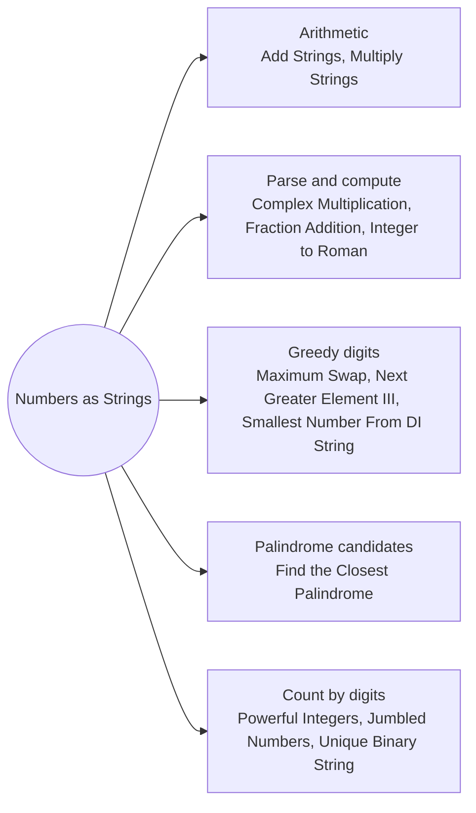

# Numbers as Strings: Pattern Map

> [!TIP]
> **🧠 One picture to keep**
> When a number is too big or its **digits are the point**, work on the digit string directly: from the right for arithmetic, from the left for greedy choices.
> 1. **Grade-school arithmetic**: carry from the right, digit i × digit j lands at i + j (Add Strings, Multiply Strings).
> 2. **Parse and compute**: split into parts, compute, format back (Complex Multiplication, Fraction Addition, Integer to Roman).
> 3. **Greedy digit moves**: the first place that can improve, the last copy of the biggest digit (Maximum Swap, Next Greater Element III, Smallest Number From DI String).
> 4. **Palindrome candidates**: mirror the left half, try ±1, add the 9…9 and 10…01 edge cases (Closest Palindrome).
> 5. **Count numbers by digits**: a digit walk with a fixed suffix (Powerful Integers), mapped keys (Jumbled Numbers), the diagonal trick (Unique Binary String).

**All animations:** [▶ Numbers as Strings Animations](https://d9-cell.github.io/java-brain/Strings/Numbers%20as%20Strings/Numbers%20as%20Strings%20Animations.html) · ⬆ [00 Brain Map](../../00%20Brain%20Map.md)

## Java toolkit
| Need | Java |
|---|---|
| Digit value | `s.charAt(i) - '0'` |
| Build from the right | `sb.append(d)` then `sb.reverse()` |
| Product slots | `pos[i + j + 1] += a * b` carry into `pos[i + j]` |
| Parse a slice | `Integer.parseInt(s.substring(a, b))`, `Long.parseLong` |
| Big values | `java.math.BigInteger` only to check, not in interviews |
| gcd for fractions | `gcd(a, b) = b == 0 ? a : gcd(b, a % b)` |

## Patterns in this folder

| # | Problem | Pattern | Mantra | Level |
|---|---|---|---|---|
| 1 | [Add Strings](Add%20Strings.md) | Carry from the right | sum = carry + d1 + d2 · append sum % 10 · carry = sum / 10 · reverse | Easy |
| 2 | [Multiply Strings](Multiply%20Strings.md) | Product slots | sum = a·b + pos[i+j+1] · pos[i+j+1] = sum % 10 · pos[i+j] += sum / 10 | Medium |
| 3 | [Integer to Roman](Integer%20to%20Roman.md) | Greedy table | FOR value desc: WHILE num ≥ value: append symbol, subtract | Medium |
| 4 | [Complex Number Multiplication](Complex%20Number%20Multiplication.md) | Parse and compute | parse a, b, c, d · real = ac − bd · imag = ad + bc | Medium |
| 5 | [Fraction Addition and Subtraction](Fraction%20Addition%20and%20Subtraction.md) | Parse and compute, gcd | num = num·b + sign·a·den · den *= b · divide both by gcd | Medium |
| 6 | [Maximum Swap](Maximum%20Swap.md) | Greedy digits, Last occurrence | last[d] = last index · FOR i: FOR k = 9 > d[i]: last[k] > i → swap, done | Medium |
| 7 | [Next Greater Element III](Next%20Greater%20Element%20III.md) | Next permutation | i = last d[i] < d[i+1] · j = last d[j] > d[i] · swap · reverse(i+1..) | Medium |
| 8 | [Find the Closest Palindrome](Find%20the%20Closest%20Palindrome.md) | Palindrome candidates | cands: 10^(L−1) − 1, 10^L + 1, mirror(half ± 0/1) · min distance, tie → smaller | Hard |
| 9 | [Sort the Jumbled Numbers](Sort%20the%20Jumbled%20Numbers.md) | Mapped keys, Stable sort | key[i] = map digits of nums[i] · sort indexes by key | Medium |
| 10 | [Construct Smallest Number From DI String](Construct%20Smallest%20Number%20From%20DI%20String.md) | Stack, Reverse D runs | push i+1 · at I or end: append stack reversed | Medium |
| 11 | [Count the Number of Powerful Integers](Count%20the%20Number%20of%20Powerful%20Integers.md) | Digit walk, Prefix count | answer = count(finish) − count(start − 1) · prefix digit d: add d·(limit+1)^rest · d > limit → add all and stop | Hard |
| 12 | [Find Unique Binary String](Find%20Unique%20Binary%20String.md) | Diagonal argument | ans[i] = nums[i][i] == '0' ? '1' : '0' | Medium |

## Suggested learning order
1. [Add Strings](Add%20Strings.md) ⭐, [Integer to Roman](Integer%20to%20Roman.md), [Complex Number Multiplication](Complex%20Number%20Multiplication.md)
2. [Multiply Strings](Multiply%20Strings.md) ⭐, [Fraction Addition and Subtraction](Fraction%20Addition%20and%20Subtraction.md)
3. [Maximum Swap](Maximum%20Swap.md), [Next Greater Element III](Next%20Greater%20Element%20III.md) ⭐, [Construct Smallest Number From DI String](Construct%20Smallest%20Number%20From%20DI%20String.md)
4. [Sort the Jumbled Numbers](Sort%20the%20Jumbled%20Numbers.md), [Find Unique Binary String](Find%20Unique%20Binary%20String.md)
5. [Find the Closest Palindrome](Find%20the%20Closest%20Palindrome.md), [Count the Number of Powerful Integers](Count%20the%20Number%20of%20Powerful%20Integers.md)

## Connections to other folders
- [Digits and Powers - Pattern Map](../../Mathematical/Digits%20and%20Powers/Digits%20and%20Powers%20-%20Pattern%20Map.md) for digit loops on real integers
- [Fraction to Recurring Decimal](../../Mathematical/Primes%20Divisors%20and%20Remainders/Fraction%20to%20Recurring%20Decimal.md) for long division in strings
- [Bitmask Digit and Tree DP - Pattern Map](../../DP/Bitmask%20Digit%20and%20Tree%20DP/Bitmask%20Digit%20and%20Tree%20DP%20-%20Pattern%20Map.md) for digit DP
