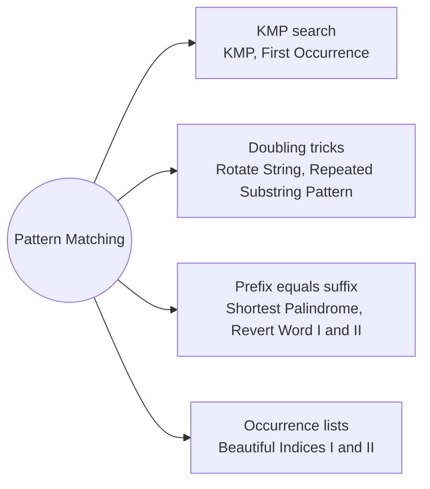

# Pattern Matching: Pattern Map

> [!TIP]
> **🧠 One picture to keep**
> Never re-read text you already matched. **KMP's lps array** (or the **Z-function**) records how much of the pattern still matches after a mismatch, giving **O(n + m)** search.
> 1. **KMP search**: lps[i] = longest proper prefix of p[0..i] that is also its suffix (KMP, First Occurrence, Beautiful Indices II).
> 2. **Doubling tricks**: rotations live in s + s, repetitions show up inside (s + s) without its ends (Rotate String, Repeated Substring Pattern).
> 3. **Prefix = suffix questions**: lps of s + "#" + reverse(s) for palindromic prefixes, Z values for "suffix equals prefix" (Shortest Palindrome, Revert Word I and II).
> 4. **Occurrence lists + window**: find every match, then pair them up with two pointers (Beautiful Indices I and II).

**All animations:** [▶ Pattern Matching Animations](https://d9-cell.github.io/java-brain/Strings/Pattern%20Matching/Pattern%20Matching%20Animations.html) · ⬆ [00 Brain Map](../../00%20Brain%20Map.md)

## Java toolkit
| Need | Java |
|---|---|
| lps build | `if (p[i] == p[len]) lps[i++] = ++len; else if (len > 0) len = lps[len - 1]; else lps[i++] = 0;` |
| KMP fallback on mismatch | `j = lps[j - 1]` (i stays) |
| After a full match | `j = lps[j - 1]` to keep finding overlaps |
| Z-box | `if (i < r) z[i] = Math.min(r - i, z[i - l]);` then extend |
| Library search | `s.indexOf(p, from)` (worst case O(n · m)) |
| Rotation test | `(s + s).contains(goal)` |

## Patterns in this folder

| # | Problem | Pattern | Mantra | Level |
|---|---|---|---|---|
| 1 | [Knuth-Morris-Pratt KMP String Matching Algorithm](Knuth-Morris-Pratt%20KMP%20String%20Matching%20Algorithm.md) | KMP, lps array | build lps · match → i++ and j++ · mismatch → j = lps[j−1] (or i++ when j = 0) · full match → record and j = lps[j−1] | Medium |
| 2 | [Find the Index of the First Occurrence in a String](Find%20the%20Index%20of%20the%20First%20Occurrence%20in%20a%20String.md) | KMP | lps(needle) · scan haystack · j == m → i − m | Easy |
| 3 | [Repeated Substring Pattern](Repeated%20Substring%20Pattern.md) | Doubling trick, lps period | (s+s)[1..2n−1).contains(s) · OR lps > 0 && n % (n − lps) == 0 | Easy |
| 4 | [Rotate String](Rotate%20String.md) | Doubling trick | |s| == |goal| && (s + s).contains(goal) | Easy |
| 5 | [Shortest Palindrome](Shortest%20Palindrome.md) | lps on s#rev(s) | lps(s # rev) · keep = last lps · rev[0..n−keep) + s | Hard |
| 6 | [Minimum Time to Revert Word to Initial State I](Minimum%20Time%20to%20Revert%20Word%20to%20Initial%20State%20I.md) | Suffix equals prefix | t = 1.. · k·t ≥ n or word.startsWith(word[k·t..]) → t | Medium |
| 7 | [Minimum Time to Revert Word to Initial State II](Minimum%20Time%20to%20Revert%20Word%20to%20Initial%20State%20II.md) | Z-function | z-function · first t with k·t ≥ n or z[k·t] == n − k·t | Hard |
| 8 | [Find Beautiful Indices in the Given Array I](Find%20Beautiful%20Indices%20in%20the%20Given%20Array%20I.md) | Occurrence lists | as = occ(a) · bs = occ(b) · keep i with a j within k | Medium |
| 9 | [Find Beautiful Indices in the Given Array II](Find%20Beautiful%20Indices%20in%20the%20Given%20Array%20II.md) | KMP, Two pointers | kmp(s, a), kmp(s, b) · advance j while bs[j] < i − k · bs[j] ≤ i + k → keep i | Hard |

## Suggested learning order
1. [Knuth-Morris-Pratt KMP String Matching Algorithm](Knuth-Morris-Pratt%20KMP%20String%20Matching%20Algorithm.md) ⭐, [Find the Index of the First Occurrence in a String](Find%20the%20Index%20of%20the%20First%20Occurrence%20in%20a%20String.md)
2. [Rotate String](Rotate%20String.md), [Repeated Substring Pattern](Repeated%20Substring%20Pattern.md)
3. [Minimum Time to Revert Word to Initial State I](Minimum%20Time%20to%20Revert%20Word%20to%20Initial%20State%20I.md), [Minimum Time to Revert Word to Initial State II](Minimum%20Time%20to%20Revert%20Word%20to%20Initial%20State%20II.md), [Shortest Palindrome](Shortest%20Palindrome.md) ⭐
4. [Find Beautiful Indices in the Given Array I](Find%20Beautiful%20Indices%20in%20the%20Given%20Array%20I.md), [Find Beautiful Indices in the Given Array II](Find%20Beautiful%20Indices%20in%20the%20Given%20Array%20II.md)

## Connections to other folders
- [Trie - Pattern Map](../../Trie/Trie%20-%20Pattern%20Map.md) for many patterns at once
- [Subsequences Stacks and Greedy - Pattern Map](../Subsequences%20Stacks%20and%20Greedy/Subsequences%20Stacks%20and%20Greedy%20-%20Pattern%20Map.md) for substring checks on small inputs
- [Palindromes and Word Splits - Pattern Map](../../DP/Palindromes%20and%20Word%20Splits/Palindromes%20and%20Word%20Splits%20-%20Pattern%20Map.md) for palindrome DP
