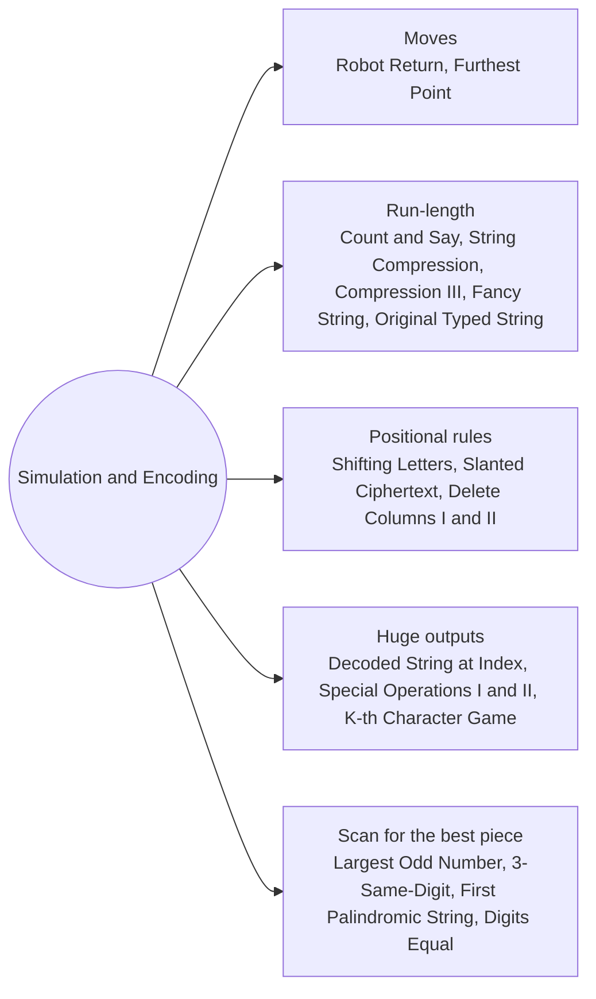

# Simulation and Encoding: Pattern Map

> [!TIP]
> **🧠 One picture to keep**
> Follow the rules **one character at a time** with a builder, and when the output would be huge, **track only its length and walk backwards**.
> 1. **Counters for moves**: net displacement decides (Robot Return, Furthest Point).
> 2. **Run-length**: find each run with two pointers, write count and letter (Count and Say, String Compression, Compression III, Fancy String, Original Typed String).
> 3. **Positional rules**: suffix sums of shifts, diagonals of a grid, column checks (Shifting Letters, Slanted Ciphertext, Delete Columns I and II).
> 4. **Huge outputs**: keep the length, then map k back through each step (Decoded String at Index, Special Operations II, K-th Character Game).
> 5. **Scan for the best piece**: last odd digit, best triple, first palindrome (Largest Odd Number, 3-Same-Digit, First Palindromic String, Digits Equal After Operations).

**All animations:** [▶ Simulation and Encoding Animations](https://d9-cell.github.io/java-brain/Strings/Simulation%20and%20Encoding/Simulation%20and%20Encoding%20Animations.html) · ⬆ [00 Brain Map](../../00%20Brain%20Map.md)

## Java toolkit
| Need | Java |
|---|---|
| Find a run | `int j = i; while (j < n && s.charAt(j) == s.charAt(i)) j++;` |
| Builder edits | `sb.append(x)`, `sb.deleteCharAt(sb.length() - 1)`, `sb.reverse()` |
| Shift a letter | `(char) ('a' + (c - 'a' + k) % 26)` |
| Count digits of a number | `String.valueOf(count).toCharArray()` |
| Cell (r, c) of a row-major grid | `text.charAt(r * cols + c)` |
| Bits set | `Integer.bitCount(x)` |

## Patterns in this folder

| # | Problem | Pattern | Mantra | Level |
|---|---|---|---|---|
| 1 | [Robot Return to Origin](Robot%20Return%20to%20Origin.md) | Net displacement | U/D change y · L/R change x · x == 0 && y == 0 | Easy |
| 2 | [Furthest Point From Origin](Furthest%20Point%20From%20Origin.md) | Net displacement, Greedy | |count L − count R| + count _ | Easy |
| 3 | [Count and Say](Count%20and%20Say.md) | Run-length | FOR run: append(count).append(digit) | Medium |
| 4 | [String Compression](String%20Compression.md) | Run-length, Read and write pointers | run [i, j) · chars[w++] = letter · len > 1 → write digits | Medium |
| 5 | [String Compression III](String%20Compression%20III.md) | Run-length | run up to 9 · append(len).append(c) | Medium |
| 6 | [Shifting Letters](Shifting%20Letters.md) | Suffix sum | FROM right: suffix = (suffix + shifts[i]) % 26 · shift a[i] | Medium |
| 7 | [Decode the Slanted Ciphertext](Decode%20the%20Slanted%20Ciphertext.md) | Grid indexing, Diagonals | cols = n / rows · FOR start col: (r, c) += (1, 1) · trim end | Medium |
| 8 | [Process String with Special Operations I](Process%20String%20with%20Special%20Operations%20I.md) | Builder simulation | letter → append · * → delete last · # → append copy · % → reverse | Medium |
| 9 | [Process String with Special Operations II](Process%20String%20with%20Special%20Operations%20II.md) | Track length, Walk back k | forward: len · backward: % → k = len−1−k · # → len /= 2, k %= len · letter at index len−1 == k → answer | Hard |
| 10 | [Decoded String at Index](Decoded%20String%20at%20Index.md) | Track length, Walk back k | size forward · back: k %= size · k == 0 at letter → it · digit → size /= d · letter → size−− | Medium |
| 11 | [Find the K-th Character in String Game I](Find%20the%20K-th%20Character%20in%20String%20Game%20I.md) | Bit counting | 'a' + bitCount(k − 1) | Easy |
| 12 | [Check If Digits Are Equal in String After Operations I](Check%20If%20Digits%20Are%20Equal%20in%20String%20After%20Operations%20I.md) | In-place reduction | WHILE len > 2: d[i] = (d[i] + d[i+1]) % 10 · d[0] == d[1] | Easy |
| 13 | [Delete Characters to Make Fancy String](Delete%20Characters%20to%20Make%20Fancy%20String.md) | Builder check | sb ends with c c → skip · ELSE append | Easy |
| 14 | [Find the Original Typed String I](Find%20the%20Original%20Typed%20String%20I.md) | Run counting | 1 + count(word[i] == word[i−1]) | Easy |
| 15 | [Delete Columns to Make Sorted](Delete%20Columns%20to%20Make%20Sorted.md) | Column scan | FOR col: any strs[r][c] < strs[r−1][c] → del++ | Easy |
| 16 | [Delete Columns to Make Sorted II](Delete%20Columns%20to%20Make%20Sorted%20II.md) | Greedy columns, Decided pairs | bad if !decided[r] && s[r][c] > s[r+1][c] → delete · ELSE mark s[r][c] < s[r+1][c] decided | Medium |
| 17 | [Largest Odd Number in String](Largest%20Odd%20Number%20in%20String.md) | Scan from the end | FROM right: first odd digit i → num[0..i] | Easy |
| 18 | [Largest 3-Same-Digit Number in String](Largest%203-Same-Digit%20Number%20in%20String.md) | Window of three | num[i] == num[i−1] == num[i−2] → best = max | Easy |
| 19 | [Find First Palindromic String in the Array](Find%20First%20Palindromic%20String%20in%20the%20Array.md) | Two pointers | l, r inward while equal · l ≥ r → palindrome | Easy |

## Suggested learning order
1. [Robot Return to Origin](Robot%20Return%20to%20Origin.md), [Furthest Point From Origin](Furthest%20Point%20From%20Origin.md), [Find First Palindromic String in the Array](Find%20First%20Palindromic%20String%20in%20the%20Array.md), [Largest Odd Number in String](Largest%20Odd%20Number%20in%20String.md), [Largest 3-Same-Digit Number in String](Largest%203-Same-Digit%20Number%20in%20String.md)
2. [Count and Say](Count%20and%20Say.md), [String Compression](String%20Compression.md) ⭐, [String Compression III](String%20Compression%20III.md), [Delete Characters to Make Fancy String](Delete%20Characters%20to%20Make%20Fancy%20String.md), [Find the Original Typed String I](Find%20the%20Original%20Typed%20String%20I.md)
3. [Shifting Letters](Shifting%20Letters.md), [Delete Columns to Make Sorted](Delete%20Columns%20to%20Make%20Sorted.md), [Delete Columns to Make Sorted II](Delete%20Columns%20to%20Make%20Sorted%20II.md), [Decode the Slanted Ciphertext](Decode%20the%20Slanted%20Ciphertext.md), [Check If Digits Are Equal in String After Operations I](Check%20If%20Digits%20Are%20Equal%20in%20String%20After%20Operations%20I.md)
4. [Process String with Special Operations I](Process%20String%20with%20Special%20Operations%20I.md), [Find the K-th Character in String Game I](Find%20the%20K-th%20Character%20in%20String%20Game%20I.md), [Process String with Special Operations II](Process%20String%20with%20Special%20Operations%20II.md) ⭐, [Decoded String at Index](Decoded%20String%20at%20Index.md) ⭐

## Connections to other folders
- [Words Parsing and Formatting - Pattern Map](../Words%20Parsing%20and%20Formatting/Words%20Parsing%20and%20Formatting%20-%20Pattern%20Map.md) for token-based building
- [Binary Strings and Substring Counting - Pattern Map](../Binary%20Strings%20and%20Substring%20Counting/Binary%20Strings%20and%20Substring%20Counting%20-%20Pattern%20Map.md) for counting over runs
- [Stack - Pattern Map](../../Stack/Stack%20-%20Pattern%20Map.md) for undo-style rules
