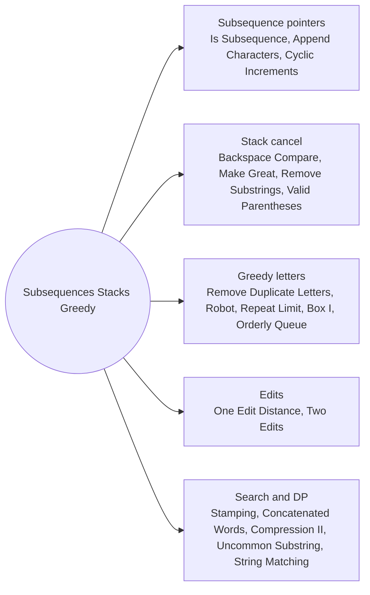

# Subsequences Stacks and Greedy: Pattern Map

> [!TIP]
> **🧠 One picture to keep**
> Three tools cover most "build or reduce a string" problems: **two pointers** for subsequences, a **stack** for cancel and undo rules, and **greedy by the smallest or largest letter**.
> 1. **Subsequence pointers**: one pointer per string, advance on a match (Is Subsequence, Append Characters, Cyclic Increments).
> 2. **Stack cancel**: the newest character cancels with the top (Backspace, Make Great, Remove Substrings, Valid Parentheses).
> 3. **Greedy smallest or largest**: monotonic stack with "seen later", suffix minimum, limited repeats (Remove Duplicate Letters, Robot, Repeat Limit, Box I, Orderly Queue).
> 4. **Edits**: count differing positions or align at the first mismatch (One Edit Distance, Two Edits).
> 5. **Search and DP**: reverse stamping, word break, all substrings (Stamping, Concatenated Words, String Compression II, Uncommon Substring, String Matching).

**All animations:** [▶ Subsequences Stacks and Greedy Animations](https://d9-cell.github.io/java-brain/Strings/Subsequences%20Stacks%20and%20Greedy/Subsequences%20Stacks%20and%20Greedy%20Animations.html) · ⬆ [00 Brain Map](../../00%20Brain%20Map.md)

## Java toolkit
| Need | Java |
|---|---|
| Stack of chars | `StringBuilder st; st.charAt(st.length() - 1); st.deleteCharAt(st.length() - 1);` |
| Same letter, other case | `Math.abs(a - b) == 32` |
| Last index per letter | `last[s.charAt(i) - 'a'] = i;` |
| Suffix minimum | `min[i] = (char) Math.min(s.charAt(i), min[i + 1]);` |
| Substring test | `big.contains(small)` |
| Memo table | `int[][] memo; Arrays.fill(row, -1)` |

## Patterns in this folder

| # | Problem | Pattern | Mantra | Level |
|---|---|---|---|---|
| 1 | [Is Subsequence](Is%20Subsequence.md) | Two pointers | s[i] == t[j] → i++ · RETURN i == |s| | Easy |
| 2 | [Append Characters to String to Make Subsequence](Append%20Characters%20to%20String%20to%20Make%20Subsequence.md) | Two pointers | greedy match t in s · RETURN |t| − matched | Medium |
| 3 | [Make String a Subsequence Using Cyclic Increments](Make%20String%20a%20Subsequence%20Using%20Cyclic%20Increments.md) | Two pointers | c == need || (c + 1) % 26 == need → j++ | Medium |
| 4 | [Backspace String Compare](Backspace%20String%20Compare.md) | Backward scan, Skip counter | nextKept(i): # → skip++ · letter with skip → skip−− · compare survivors | Easy |
| 5 | [Make The String Great](Make%20The%20String%20Great.md) | Stack cancel | |top − c| == 32 → pop · ELSE push | Easy |
| 6 | [Minimum String Length After Removing Substrings](Minimum%20String%20Length%20After%20Removing%20Substrings.md) | Stack cancel | c == 'B' && top == 'A' or c == 'D' && top == 'C' → pop · ELSE push | Easy |
| 7 | [Minimum Remove to Make Valid Parentheses](Minimum%20Remove%20to%20Make%20Valid%20Parentheses.md) | Balance counter, Two passes | pass 1: open count, skip bad ) · pass 2 from the right: skip open extra ( | Medium |
| 8 | [Remove Duplicate Letters](Remove%20Duplicate%20Letters.md) | Monotonic stack, Last occurrence | in stack → skip · WHILE top > c && last[top] > i: pop · push c | Medium |
| 9 | [Using a Robot to Print the Lexicographically Smallest String](Using%20a%20Robot%20to%20Print%20the%20Lexicographically%20Smallest%20String.md) | Stack, Suffix minimum | minSuffix · push s[i] · WHILE top ≤ minSuffix[i+1]: print top | Medium |
| 10 | [Construct String With Repeat Limit](Construct%20String%20With%20Repeat%20Limit.md) | Greedy by largest letter | take min(cnt, limit) of cur · cnt left → one of next · no next → stop | Medium |
| 11 | [Find the Lexicographically Largest String From the Box I](Find%20the%20Lexicographically%20Largest%20String%20From%20the%20Box%20I.md) | Greedy start, Length cap | friends == 1 → word · maxLen = n − f + 1 · best = max over i of word[i..i+maxLen) | Medium |
| 12 | [Orderly Queue](Orderly%20Queue.md) | Case split | k > 1 → sorted · k == 1 → min rotation | Hard |
| 13 | [One Edit Distance](One%20Edit%20Distance.md) | First mismatch | len diff > 1 → false · mismatch: replace or insert check · none: lengths differ by 1 | Medium |
| 14 | [Words Within Two Edits of Dictionary](Words%20Within%20Two%20Edits%20of%20Dictionary.md) | Hamming distance | FOR query: any dict word with ≤ 2 differences → keep | Medium |
| 15 | [String Compression II](String%20Compression%20II.md) | Memo DP, Keep one letter | dp = min(dp(i+1, k−1), FOR j: enc(same) + dp(j+1, k − diff)) | Hard |
| 16 | [Stamping The Sequence](Stamping%20The%20Sequence.md) | Reverse process, Greedy | FOR window: matches with ? wildcards and changes ≥ 1 letter → ?…? · reverse moves | Hard |
| 17 | [Concatenated Words](Concatenated%20Words.md) | Word break | remove w · can[j] = can[i] && dict.contains(w[i..j)) · put w back | Hard |
| 18 | [Shortest Uncommon Substring in an Array](Shortest%20Uncommon%20Substring%20in%20an%20Array.md) | All substrings, Ownership count | owners[sub]++ per word · FOR len up: smallest sub with owners == 1 | Medium |
| 19 | [String Matching in an Array](String%20Matching%20in%20an%20Array.md) | Substring test | any j ≠ i: words[j].contains(words[i]) → keep | Easy |

## Suggested learning order
1. [Is Subsequence](Is%20Subsequence.md) ⭐, [Append Characters to String to Make Subsequence](Append%20Characters%20to%20String%20to%20Make%20Subsequence.md), [Make String a Subsequence Using Cyclic Increments](Make%20String%20a%20Subsequence%20Using%20Cyclic%20Increments.md)
2. [Backspace String Compare](Backspace%20String%20Compare.md), [Make The String Great](Make%20The%20String%20Great.md), [Minimum String Length After Removing Substrings](Minimum%20String%20Length%20After%20Removing%20Substrings.md), [Minimum Remove to Make Valid Parentheses](Minimum%20Remove%20to%20Make%20Valid%20Parentheses.md) ⭐
3. [Remove Duplicate Letters](Remove%20Duplicate%20Letters.md) ⭐, [Using a Robot to Print the Lexicographically Smallest String](Using%20a%20Robot%20to%20Print%20the%20Lexicographically%20Smallest%20String.md), [Construct String With Repeat Limit](Construct%20String%20With%20Repeat%20Limit.md)
4. [Find the Lexicographically Largest String From the Box I](Find%20the%20Lexicographically%20Largest%20String%20From%20the%20Box%20I.md), [Orderly Queue](Orderly%20Queue.md), [String Matching in an Array](String%20Matching%20in%20an%20Array.md)
5. [One Edit Distance](One%20Edit%20Distance.md), [Words Within Two Edits of Dictionary](Words%20Within%20Two%20Edits%20of%20Dictionary.md), [Shortest Uncommon Substring in an Array](Shortest%20Uncommon%20Substring%20in%20an%20Array.md)
6. [Concatenated Words](Concatenated%20Words.md), [Stamping The Sequence](Stamping%20The%20Sequence.md), [String Compression II](String%20Compression%20II.md)

## Connections to other folders
- [Stack - Pattern Map](../../Stack/Stack%20-%20Pattern%20Map.md) for more cancel-style stacks
- [Strings and Digits - Pattern Map](../../Greedy/Strings%20and%20Digits/Strings%20and%20Digits%20-%20Pattern%20Map.md) in Greedy for digit-removal greedy
- [Palindromes and Word Splits - Pattern Map](../../DP/Palindromes%20and%20Word%20Splits/Palindromes%20and%20Word%20Splits%20-%20Pattern%20Map.md) for word break
- [Trie - Pattern Map](../../Trie/Trie%20-%20Pattern%20Map.md) for dictionary lookups
