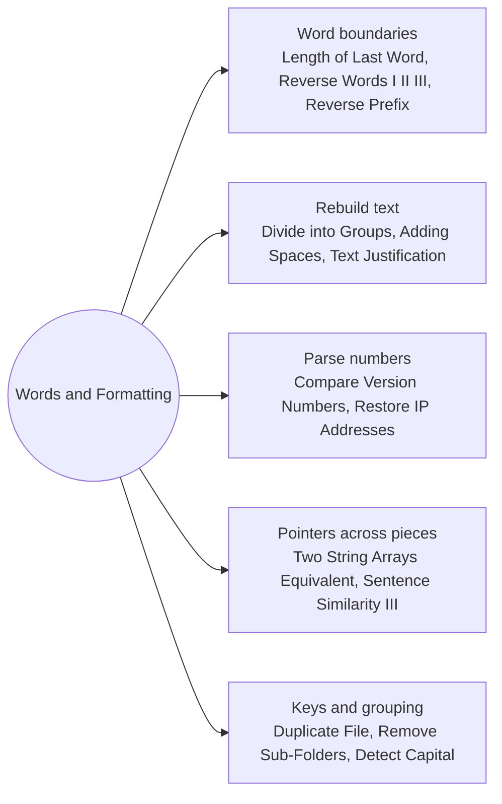

# Words Parsing and Formatting: Pattern Map

> [!TIP]
> **🧠 One picture to keep**
> Treat text as **tokens between separators**. Find token boundaries with two indexes, then reverse, compare, group or lay them out.
> 1. **Word boundaries**: skip spaces, mark start and end (Length of Last Word, Reverse Words I, II, III, Reverse Prefix).
> 2. **Rebuild with a builder**: cut, pad, insert (Divide into Groups, Adding Spaces, Text Justification).
> 3. **Parse numbers out of text**: read digits until a separator (Compare Version Numbers, Restore IP Addresses).
> 4. **Pointers across pieces**: compare without concatenating (Two String Arrays Equivalent, Sentence Similarity III).
> 5. **Keys and grouping**: group by content, sort paths (Duplicate File, Remove Sub-Folders), and simple case rules (Detect Capital).

**All animations:** [▶ Words Parsing and Formatting Animations](https://d9-cell.github.io/java-brain/Strings/Words%20Parsing%20and%20Formatting/Words%20Parsing%20and%20Formatting%20Animations.html) · ⬆ [00 Brain Map](../../00%20Brain%20Map.md)

## Java toolkit
| Need | Java |
|---|---|
| Split on runs of spaces | `s.trim().split("\\s+")` |
| Append a slice | `sb.append(s, from, to)` |
| Reverse a slice in place | `while (l < r) { char t = a[l]; a[l++] = a[r]; a[r--] = t; }` |
| Repeat spaces | `" ".repeat(n)` |
| Parse digits by hand | `x = x * 10 + (c - '0')` |
| Group by key | `map.computeIfAbsent(key, k -> new ArrayList<>()).add(v)` |

## Patterns in this folder

| # | Problem | Pattern | Mantra | Level |
|---|---|---|---|---|
| 1 | [Length of Last Word](Length%20of%20Last%20Word.md) | Scan from the end | skip spaces from the right · count until space | Easy |
| 2 | [Reverse Words in a String](Reverse%20Words%20in%20a%20String.md) | Word boundaries | skip spaces · end = i · move to word start · append s[i+1..end] | Medium |
| 3 | [Reverse Words in a String II](Reverse%20Words%20in%20a%20String%20II.md) | Reverse twice | reverse(all) · reverse(each word) | Medium |
| 4 | [Reverse Words in a String III](Reverse%20Words%20in%20a%20String%20III.md) | Word boundaries, Two pointers | FOR each word [start, i): swap ends inward | Easy |
| 5 | [Reverse Prefix of Word](Reverse%20Prefix%20of%20Word.md) | Prefix reverse | j = indexOf(ch) · j < 0 → word · reverse(0..j) + rest | Easy |
| 6 | [Divide a String Into Groups of Size k](Divide%20a%20String%20Into%20Groups%20of%20Size%20k.md) | Chunking | groups = (n + k − 1) / k · i < n ? s[i] : fill | Easy |
| 7 | [Adding Spaces to a String](Adding%20Spaces%20to%20a%20String.md) | Two pointers, Builder | spaces[j] == i → append " ", j++ · append s[i] | Medium |
| 8 | [Check If Two String Arrays are Equivalent](Check%20If%20Two%20String%20Arrays%20are%20Equivalent.md) | Pointers across pieces | compare chars · advance c, wrap to next word · both must end together | Easy |
| 9 | [Text Justification](Text%20Justification.md) | Greedy lines, Space distribution | fit words · each = sp / gaps · extra = sp % gaps to the left · last line: single spaces + pad | Hard |
| 10 | [Compare Version Numbers](Compare%20Version%20Numbers.md) | Parse numbers, Two pointers | parse until "." on both sides · differ → ±1 · end → 0 | Medium |
| 11 | [Find Duplicate File in System](Find%20Duplicate%20File%20in%20System.md) | Group by key | content → list of dir/name · keep size > 1 | Medium |
| 12 | [Remove Sub-Folders from the Filesystem](Remove%20Sub-Folders%20from%20the%20Filesystem.md) | Sort, Prefix check | sort · keep f unless f.startsWith(lastKept + "/") | Medium |
| 13 | [Sentence Similarity III](Sentence%20Similarity%20III.md) | Two pointers, Prefix and suffix | front matches · back matches (not overlapping) · front + back == shorter length | Medium |
| 14 | [Restore IP Addresses](Restore%20IP%20Addresses.md) | Backtracking, Parse numbers | part = s[i..i+len] · leading 0 or > 255 → stop · 4 parts and end → add | Medium |
| 15 | [Detect Capital](Detect%20Capital.md) | Count capitals | caps == 0 || caps == n || (caps == 1 && first upper) | Easy |

## Suggested learning order
1. [Length of Last Word](Length%20of%20Last%20Word.md), [Detect Capital](Detect%20Capital.md), [Reverse Prefix of Word](Reverse%20Prefix%20of%20Word.md), [Reverse Words in a String III](Reverse%20Words%20in%20a%20String%20III.md)
2. [Reverse Words in a String](Reverse%20Words%20in%20a%20String.md) ⭐, [Reverse Words in a String II](Reverse%20Words%20in%20a%20String%20II.md)
3. [Divide a String Into Groups of Size k](Divide%20a%20String%20Into%20Groups%20of%20Size%20k.md), [Adding Spaces to a String](Adding%20Spaces%20to%20a%20String.md), [Check If Two String Arrays are Equivalent](Check%20If%20Two%20String%20Arrays%20are%20Equivalent.md)
4. [Compare Version Numbers](Compare%20Version%20Numbers.md) ⭐, [Restore IP Addresses](Restore%20IP%20Addresses.md), [Sentence Similarity III](Sentence%20Similarity%20III.md)
5. [Find Duplicate File in System](Find%20Duplicate%20File%20in%20System.md), [Remove Sub-Folders from the Filesystem](Remove%20Sub-Folders%20from%20the%20Filesystem.md), [Text Justification](Text%20Justification.md) ⭐

## Connections to other folders
- [Character Counts and Anagrams - Pattern Map](../Character%20Counts%20and%20Anagrams/Character%20Counts%20and%20Anagrams%20-%20Pattern%20Map.md) for letter counts
- [Simulation and Encoding - Pattern Map](../Simulation%20and%20Encoding/Simulation%20and%20Encoding%20-%20Pattern%20Map.md) for rule-by-rule string building
- [Backtracking - Pattern Map](../../Backtracking/Backtracking%20-%20Pattern%20Map.md) for the search behind Restore IP Addresses
