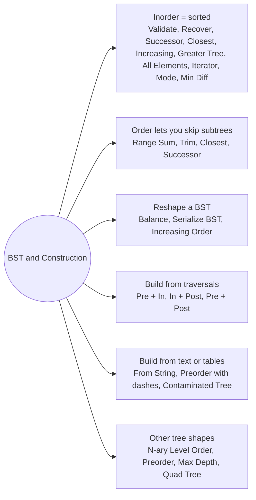

# BST and Construction: Pattern Map

> [!TIP]
> **🧠 One picture to keep**
> Two ideas, one folder:
> 1. **A BST is a sorted array in disguise.** Inorder = sorted order, so nearest key, k-th key, successor, mode, minimum difference, merge and greater-sum are all "walk inorder and remember the previous key". Ordering also lets searches skip whole subtrees (range sum, trim, LCA).
> 2. **Rebuilding a tree from a traversal**: one traversal says *which node is the root*, the other says *how big the left part is*. Preorder / postorder give the root; inorder gives the sizes. Strings, parent tables and grids are rebuilt with the same split-and-recurse idea.
> N-ary trees (children list instead of left/right) and the quad tree sit here as the other "tree shapes" you meet.

**All animations:** [▶ BST and Construction Animations](https://d9-cell.github.io/java-brain/Tree/BST%20and%20Construction/BST%20and%20Construction%20Animations.html) · ⬆ [00 Brain Map](../../00%20Brain%20Map.md)

## Java toolkit
| Need | Java |
|---|---|
| Inorder with a stack | `while (cur != null \|\| !st.isEmpty()) { while (cur != null) { st.push(cur); cur = cur.left; } cur = st.pop(); ... cur = cur.right; }` |
| Reverse inorder | swap `left` and `right` in the loop above: largest to smallest |
| Previous-key trick | keep `prev`; compare `cur` with `prev` (validate, min difference, mode, recover) |
| Index of a value in inorder | `Map<Integer, Integer> pos` built once, so splitting is O(1) |
| Shared position while parsing | `int[] i = {0}` passed down (no fields) |
| BST bounds | `long lo = Long.MIN_VALUE, hi = Long.MAX_VALUE` so `Integer.MIN_VALUE` keys are valid |

## Patterns in this folder

| # | Problem | Pattern | Mantra | Level |
|---|---|---|---|---|
| 1 | [Validate Binary Search Tree](Validate%20Binary%20Search%20Tree.md) | Bounds, Inorder strictly increasing | WINDOW (lo, hi) SHRINKS GOING DOWN | Medium |
| 2 | [Recover Binary Search Tree](Recover%20Binary%20Search%20Tree.md) | Inorder with previous key, Morris traversal | FIRST BIG AT DIP 1, LAST SMALL AT DIP 2 | Medium |
| 3 | [Inorder Successor in BST](Inorder%20Successor%20in%20BST.md) | Walk down remembering the last left turn | GO LEFT → REMEMBER, GO RIGHT → FORGET | Medium |
| 4 | [Find the Closest Element in BST](Find%20the%20Closest%20Element%20in%20BST.md) | Search path, Track the best difference | FOLLOW THE SEARCH PATH, KEEP MIN |k − node| | Easy |
| 5 | [Increasing Order Search Tree](Increasing%20Order%20Search%20Tree.md) | Inorder relinking | INORDER, left = null, tail.right = node | Easy |
| 6 | [Convert BST to Greater Tree](Convert%20BST%20to%20Greater%20Tree.md) | Reverse inorder, Running sum | RIGHT, NODE, LEFT; sum += val; val = sum | Medium |
| 7 | [All Elements in Two Binary Search Trees](All%20Elements%20in%20Two%20Binary%20Search%20Trees.md) | Inorder, Merge two sorted streams | INORDER BOTH, MERGE LIKE MERGE SORT | Medium |
| 8 | [Binary Search Tree Iterator](Binary%20Search%20Tree%20Iterator.md) | Controlled inorder, Stack of the left spine | PUSH LEFT SPINE, POP, PUSH LEFT SPINE OF RIGHT | Medium |
| 9 | [Serialize and Deserialize BST](Serialize%20and%20Deserialize%20BST.md) | Preorder, Value bounds | PREORDER OUT, BOUNDS IN | Medium |
| 10 | [Balance a Binary Search Tree](Balance%20a%20Binary%20Search%20Tree.md) | Inorder, Middle as root | INORDER LIST, MIDDLE IS THE ROOT | Medium |
| 11 | [Find Mode in Binary Search Tree](Find%20Mode%20in%20Binary%20Search%20Tree.md) | Inorder, Run length of equal keys | RUN LENGTH ON THE INORDER STREAM | Easy |
| 12 | [Minimum Absolute Difference in BST](Minimum%20Absolute%20Difference%20in%20BST.md) | Inorder, Adjacent keys | INORDER, DIFF WITH PREVIOUS | Easy |
| 13 | [Range Sum of BST](Range%20Sum%20of%20BST.md) | Prune by ordering | TOO SMALL → RIGHT, TOO BIG → LEFT | Easy |
| 14 | [Trim a Binary Search Tree](Trim%20a%20Binary%20Search%20Tree.md) | Prune by ordering, Return a node | TOO SMALL → RETURN TRIM(RIGHT), TOO BIG → TRIM(LEFT) | Medium |
| 15 | [Construct Binary Tree from Preorder and Inorder Traversal](Construct%20Binary%20Tree%20from%20Preorder%20and%20Inorder%20Traversal.md) | Root from preorder, Split by inorder | PREORDER = ROOT, INORDER = SPLIT | Medium |
| 16 | [Construct Binary Tree from Inorder and Postorder Traversal](Construct%20Binary%20Tree%20from%20Inorder%20and%20Postorder%20Traversal.md) | Root from postorder, Split by inorder | POSTORDER FROM THE END, BUILD RIGHT FIRST | Medium |
| 17 | [Construct Binary Tree from Preorder and Postorder Traversal](Construct%20Binary%20Tree%20from%20Preorder%20and%20Postorder%20Traversal.md) | Left subtree size from postorder | pre[1] IS THE LEFT ROOT; ITS POST INDEX GIVES THE SIZE | Medium |
| 18 | [Construct Binary Tree from String](Construct%20Binary%20Tree%20from%20String.md) | Recursive descent, Parsing with an index | NUMBER, ( LEFT ), ( RIGHT ) | Medium |
| 19 | [Recover a Tree From Preorder Traversal](Recover%20a%20Tree%20From%20Preorder%20Traversal.md) | Depth from dashes, Stack of the current path | POP TO DEPTH, ATTACH LEFT THEN RIGHT | Hard |
| 20 | [Find Elements in a Contaminated Binary Tree](Find%20Elements%20in%20a%20Contaminated%20Binary%20Tree.md) | Recompute values, Heap-style numbering | REPLAY 2x+1 / 2x+2, STORE IN A SET | Medium |
| 21 | [N-ary Tree Level Order Traversal](N-ary%20Tree%20Level%20Order%20Traversal.md) | Level scan, Children list | BFS BY LEVEL, addAll(children) | Medium |
| 22 | [N-ary Tree Preorder Traversal](N-ary%20Tree%20Preorder%20Traversal.md) | Preorder, Reverse push | NODE, THEN CHILDREN; STACK PUSHES CHILDREN REVERSED | Easy |
| 23 | [Maximum Depth of N-ary Tree](Maximum%20Depth%20of%20N-ary%20Tree.md) | Depth, Max over children | 1 + MAX(DEPTH OF CHILDREN) | Easy |
| 24 | [Construct Quad Tree](Construct%20Quad%20Tree.md) | Split into four, Uniform check | UNIFORM → LEAF, ELSE FOUR QUADRANTS | Medium |

## Suggested learning order
1. Inorder basics: [Validate Binary Search Tree](Validate%20Binary%20Search%20Tree.md) ⭐, [Minimum Absolute Difference in BST](Minimum%20Absolute%20Difference%20in%20BST.md), [Range Sum of BST](Range%20Sum%20of%20BST.md), [Binary Search Tree Iterator](Binary%20Search%20Tree%20Iterator.md)
2. Navigation: [Inorder Successor in BST](Inorder%20Successor%20in%20BST.md), [Find the Closest Element in BST](Find%20the%20Closest%20Element%20in%20BST.md), [Trim a Binary Search Tree](Trim%20a%20Binary%20Search%20Tree.md)
3. Reshaping: [Increasing Order Search Tree](Increasing%20Order%20Search%20Tree.md), [Convert BST to Greater Tree](Convert%20BST%20to%20Greater%20Tree.md), [Balance a Binary Search Tree](Balance%20a%20Binary%20Search%20Tree.md), [All Elements in Two Binary Search Trees](All%20Elements%20in%20Two%20Binary%20Search%20Trees.md)
4. Hard: [Recover Binary Search Tree](Recover%20Binary%20Search%20Tree.md) ⭐, [Serialize and Deserialize BST](Serialize%20and%20Deserialize%20BST.md), [Find Mode in Binary Search Tree](Find%20Mode%20in%20Binary%20Search%20Tree.md)
5. Build from traversals: [Construct Binary Tree from Preorder and Inorder Traversal](Construct%20Binary%20Tree%20from%20Preorder%20and%20Inorder%20Traversal.md) ⭐, [Construct Binary Tree from Inorder and Postorder Traversal](Construct%20Binary%20Tree%20from%20Inorder%20and%20Postorder%20Traversal.md), [Construct Binary Tree from Preorder and Postorder Traversal](Construct%20Binary%20Tree%20from%20Preorder%20and%20Postorder%20Traversal.md)
6. Text and tables: [Construct Binary Tree from String](Construct%20Binary%20Tree%20from%20String.md), [Recover a Tree From Preorder Traversal](Recover%20a%20Tree%20From%20Preorder%20Traversal.md), [Find Elements in a Contaminated Binary Tree](Find%20Elements%20in%20a%20Contaminated%20Binary%20Tree.md)
7. Other shapes: [N-ary Tree Level Order Traversal](N-ary%20Tree%20Level%20Order%20Traversal.md), [N-ary Tree Preorder Traversal](N-ary%20Tree%20Preorder%20Traversal.md), [Maximum Depth of N-ary Tree](Maximum%20Depth%20of%20N-ary%20Tree.md), [Construct Quad Tree](Construct%20Quad%20Tree.md)

## Connections to other folders
- [Traversals and Views - Pattern Map](../Traversals%20and%20Views/Traversals%20and%20Views%20-%20Pattern%20Map.md) has the Morris traversal used by the O(1) space versions
- [LCA Distance and Tree Graphs - Pattern Map](../LCA%20Distance%20and%20Tree%20Graphs/LCA%20Distance%20and%20Tree%20Graphs%20-%20Pattern%20Map.md) for the BST LCA
