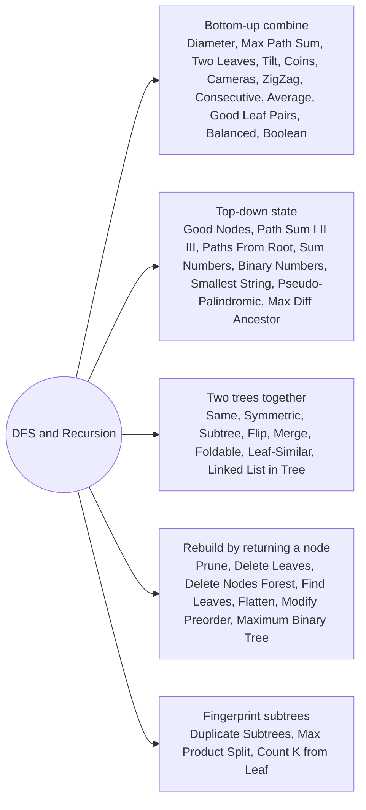

# DFS and Recursion: Pattern Map

> [!TIP]
> **🧠 One picture to keep**
> Trust the recursion: **solve for one node assuming both children are already solved.** Three shapes cover this folder:
> 1. **Bottom-up (post-order)**: children return a number, the node combines them and updates a global best. Diameter, max path sum, tilt, coins, cameras, zigzag.
> 2. **Top-down (pre-order)**: the parent passes state down. Path sums, good nodes, root-to-leaf numbers, prefix sums.
> 3. **Two trees at once**: walk both together. Same, symmetric, subtree, flip, merge, foldable.
> Only one question matters at each node: *what do I return, and what do I record on the side?*

**All animations:** [▶ DFS and Recursion Animations](https://d9-cell.github.io/java-brain/Tree/DFS%20and%20Recursion/DFS%20and%20Recursion%20Animations.html) · ⬆ [00 Brain Map](../../00%20Brain%20Map.md)

## Java toolkit
| Need | Java |
|---|---|
| Global best from a helper | `int[] best = {0};` passed down (no fields, so the helper stays reusable) |
| Return two values | `new int[]{a, b}` |
| Backtracking path | `path.add(v); recurse; path.remove(path.size() - 1);` |
| Copy a path at a leaf | `res.add(new ArrayList<>(path))` |
| Running prefix sums | `Map<Long, Integer>`; add on entry, subtract on exit |
| Deep trees | recursion depth up to n; LeetCode limits it to about 1e4, an iterative stack is the fallback |
| Bit mask for parity | `mask ^= 1 << digit`, palindrome check `(mask & (mask - 1)) == 0` |

## Patterns in this folder

| # | Problem | Pattern | Mantra | Level |
|---|---|---|---|---|
| 1 | [Diameter of Binary Tree](Diameter%20of%20Binary%20Tree.md) | Bottom-up combine, Return height, record best | RETURN HEIGHT, RECORD LEFT + RIGHT | Easy |
| 2 | [Binary Tree Maximum Path Sum](Binary%20Tree%20Maximum%20Path%20Sum.md) | Bottom-up combine, Return one arm, record both | RETURN ONE ARM, RECORD BOTH, DROP NEGATIVES | Hard |
| 3 | [Maximum Path Sum between 2 Leaf Nodes](Maximum%20Path%20Sum%20between%202%20Leaf%20Nodes.md) | Bottom-up combine, Two-children nodes only | ONLY A NODE WITH TWO KIDS CLOSES A PATH | Hard |
| 4 | [Binary Tree Tilt](Binary%20Tree%20Tilt.md) | Bottom-up combine, Return sum, record difference | RETURN SUBTREE SUM, ADD |L − R| | Easy |
| 5 | [Distribute Coins in Binary Tree](Distribute%20Coins%20in%20Binary%20Tree.md) | Bottom-up combine, Flow across each edge | EDGE COST = |COINS − NODES| OF SUBTREE | Medium |
| 6 | [Binary Tree Cameras](Binary%20Tree%20Cameras.md) | Greedy states, Tree DP | LEAF PARENT GETS THE CAMERA | Hard |
| 7 | [Longest ZigZag Path in a Binary Tree](Longest%20ZigZag%20Path%20in%20a%20Binary%20Tree.md) | Bottom-up combine, Alternate directions | KEEP THE TURN → +1, SAME SIDE → RESTART AT 1 | Medium |
| 8 | [Binary Tree Longest Consecutive Sequence](Binary%20Tree%20Longest%20Consecutive%20Sequence.md) | Top-down state, Streak from parent | CHILD == PARENT + 1 → STREAK + 1 | Medium |
| 9 | [Binary Tree Longest Consecutive Sequence II](Binary%20Tree%20Longest%20Consecutive%20Sequence%20II.md) | Bottom-up combine, Increasing and decreasing chains | RETURN {INC, DEC}, RECORD INC + DEC − 1 | Medium |
| 10 | [Count Good Nodes in Binary Tree](Count%20Good%20Nodes%20in%20Binary%20Tree.md) | Top-down state, Path maximum | CARRY MAX SO FAR, NODE >= MAX → GOOD | Medium |
| 11 | [Count Nodes Equal to Average of Subtree](Count%20Nodes%20Equal%20to%20Average%20of%20Subtree.md) | Bottom-up combine, Return sum and count | RETURN {SUM, COUNT}, CHECK SUM / COUNT | Medium |
| 12 | [Maximum Difference Between Node and Ancestor](Maximum%20Difference%20Between%20Node%20and%20Ancestor.md) | Top-down state, Path min and max | CARRY MIN AND MAX, SPREAD AT THE LEAF | Medium |
| 13 | [Maximum Product of Splitted Binary Tree](Maximum%20Product%20of%20Splitted%20Binary%20Tree.md) | Subtree sums, Maximise s * (total - s) | SUBTREE SUM s, MAXIMISE s·(T − s) | Medium |
| 14 | [Path Sum](Path%20Sum.md) | Top-down state, Remaining target | SUBTRACT AS YOU GO, ZERO AT A LEAF | Easy |
| 15 | [Path Sum II](Path%20Sum%20II.md) | Backtracking, Top-down state | ADD, RECURSE, REMOVE; COPY AT THE LEAF | Medium |
| 16 | [Path Sum III](Path%20Sum%20III.md) | Prefix sums on a tree, Hash map with backtracking | COUNT prefix − target, THEN ADD prefix | Medium |
| 17 | [Paths from Root with a Specified Sum](Paths%20from%20Root%20with%20a%20Specified%20Sum.md) | Backtracking, Prefix from the root | RECORD WHEN SUM == TARGET, KEEP GOING | Medium |
| 18 | [Sum Root to Leaf Numbers](Sum%20Root%20to%20Leaf%20Numbers.md) | Top-down state, Number built on the way down | cur = cur·10 + digit, ADD AT LEAVES | Medium |
| 19 | [Smallest String Starting From Leaf](Smallest%20String%20Starting%20From%20Leaf.md) | Top-down state, Prepend while descending | PREPEND LETTER, COMPARE AT LEAVES | Medium |
| 20 | [Pseudo-Palindromic Paths in a Binary Tree](Pseudo-Palindromic%20Paths%20in%20a%20Binary%20Tree.md) | Bit mask parity, Top-down state | XOR A BIT, mask & (mask−1) == 0 | Medium |
| 21 | [Number of Good Leaf Nodes Pairs](Number%20of%20Good%20Leaf%20Nodes%20Pairs.md) | Bottom-up combine, Distance histogram | RETURN LEAF DISTANCE COUNTS, PAIR AT THE NODE | Medium |
| 22 | [Delete Leaves With a Given Value](Delete%20Leaves%20With%20a%20Given%20Value.md) | Rebuild by returning a node, Post-order | CLEAN CHILDREN FIRST, THEN DROP MYSELF | Medium |
| 23 | [Binary Tree Pruning](Binary%20Tree%20Pruning.md) | Rebuild by returning a node, Post-order | KEEP IF SUBTREE HAS A 1 | Medium |
| 24 | [Delete Nodes And Return Forest](Delete%20Nodes%20And%20Return%20Forest.md) | Rebuild by returning a node, Forest roots | DELETED NODE RETURNS null, CHILDREN BECOME ROOTS | Medium |
| 25 | [Find Leaves Of Binary Tree](Find%20Leaves%20Of%20Binary%20Tree.md) | Height grouping, Post-order | GROUP BY HEIGHT | Medium |
| 26 | [Find Duplicate Subtrees](Find%20Duplicate%20Subtrees.md) | Fingerprint subtrees, Hash map of serializations | SERIALIZE, COUNT, REPORT AT 2 | Medium |
| 27 | [Flip Equivalent Binary Trees](Flip%20Equivalent%20Binary%20Trees.md) | Two trees together, Straight or crossed | SAME VALUE, (L=L & R=R) OR (L=R & R=L) | Medium |
| 28 | [Same Tree](Same%20Tree.md) | Two trees together, Parallel walk | BOTH null, OR SAME VALUE AND SAME CHILDREN | Easy |
| 29 | [Symmetric Tree](Symmetric%20Tree.md) | Two trees together, Mirror walk | LEFT.LEFT ↔ RIGHT.RIGHT, LEFT.RIGHT ↔ RIGHT.LEFT | Easy |
| 30 | [Subtree of Another Tree](Subtree%20of%20Another%20Tree.md) | Two trees together, Try every start | EVERY NODE IS A CANDIDATE ROOT | Easy |
| 31 | [Foldable Binary Tree](Foldable%20Binary%20Tree.md) | Two trees together, Mirror shape | SHAPE MIRRORS, VALUES DO NOT MATTER | Easy |
| 32 | [Leaf-Similar Trees](Leaf-Similar%20Trees.md) | Two trees together, Leaf sequence | COMPARE THE LEAF SEQUENCES | Easy |
| 33 | [Merge Two Binary Trees](Merge%20Two%20Binary%20Trees.md) | Two trees together, Overlay | NULL → TAKE THE OTHER, ELSE ADD | Easy |
| 34 | [Balanced Binary Tree](Balanced%20Binary%20Tree.md) | Bottom-up combine, Early exit with -1 | HEIGHT OR −1 | Easy |
| 35 | [Evaluate Boolean Binary Tree](Evaluate%20Boolean%20Binary%20Tree.md) | Bottom-up combine, Expression tree | LEAF = VALUE, INNER = OP(LEFT, RIGHT) | Easy |
| 36 | [Sum of Left Leaves](Sum%20of%20Left%20Leaves.md) | Top-down state, Left flag | PASS isLeft, COUNT LEAVES WITH IT | Easy |
| 37 | [Sum of Root To Leaf Binary Numbers](Sum%20of%20Root%20To%20Leaf%20Binary%20Numbers.md) | Top-down state, Shift and add a bit | cur = (cur << 1) | bit | Easy |
| 38 | [Linked List in Binary Tree](Linked%20List%20in%20Binary%20Tree.md) | Two trees together, Match a list downward | EVERY NODE IS A START, THEN MATCH DOWN | Medium |
| 39 | [Flatten Binary Tree to Linked List](Flatten%20Binary%20Tree%20to%20Linked%20List.md) | Rebuild by returning a node, Reverse preorder | RIGHT, LEFT, THEN LINK TO PREV | Medium |
| 40 | [Modify Tree for Preorder Using Only Right Pointers](Modify%20Tree%20for%20Preorder%20Using%20Only%20Right%20Pointers.md) | Rebuild by returning a node, Reverse preorder | FLATTEN CHILDREN, SPLICE LEFT IN THE MIDDLE | Medium |
| 41 | [Maximum Binary Tree](Maximum%20Binary%20Tree.md) | Build from an array, Monotonic stack | MAX IS THE ROOT, SPLIT AROUND IT | Medium |
| 42 | [Count the Nodes at Distance K from Leaf](Count%20the%20Nodes%20at%20Distance%20K%20from%20Leaf.md) | Path storage, Distance sets | k BACK FROM EACH LEAF, DEDUPE | Medium |

## Suggested learning order
1. Warm up: [Same Tree](Same%20Tree.md), [Symmetric Tree](Symmetric%20Tree.md), [Balanced Binary Tree](Balanced%20Binary%20Tree.md), [Sum of Left Leaves](Sum%20of%20Left%20Leaves.md), [Merge Two Binary Trees](Merge%20Two%20Binary%20Trees.md)
2. Return-and-record: [Diameter of Binary Tree](Diameter%20of%20Binary%20Tree.md) ⭐, [Binary Tree Tilt](Binary%20Tree%20Tilt.md), [Binary Tree Maximum Path Sum](Binary%20Tree%20Maximum%20Path%20Sum.md) ⭐, [Longest ZigZag Path in a Binary Tree](Longest%20ZigZag%20Path%20in%20a%20Binary%20Tree.md)
3. Top-down state: [Count Good Nodes in Binary Tree](Count%20Good%20Nodes%20in%20Binary%20Tree.md), [Path Sum](Path%20Sum.md), [Path Sum II](Path%20Sum%20II.md), [Path Sum III](Path%20Sum%20III.md) ⭐, [Sum Root to Leaf Numbers](Sum%20Root%20to%20Leaf%20Numbers.md)
4. Rebuild: [Binary Tree Pruning](Binary%20Tree%20Pruning.md), [Delete Leaves With a Given Value](Delete%20Leaves%20With%20a%20Given%20Value.md), [Delete Nodes And Return Forest](Delete%20Nodes%20And%20Return%20Forest.md), [Flatten Binary Tree to Linked List](Flatten%20Binary%20Tree%20to%20Linked%20List.md)
5. Hard: [Binary Tree Cameras](Binary%20Tree%20Cameras.md), [Distribute Coins in Binary Tree](Distribute%20Coins%20in%20Binary%20Tree.md), [Find Duplicate Subtrees](Find%20Duplicate%20Subtrees.md), [Number of Good Leaf Nodes Pairs](Number%20of%20Good%20Leaf%20Nodes%20Pairs.md)

## Connections to other folders
- [Traversals and Views - Pattern Map](../Traversals%20and%20Views/Traversals%20and%20Views%20-%20Pattern%20Map.md) for level-based answers
- [LCA Distance and Tree Graphs - Pattern Map](../LCA%20Distance%20and%20Tree%20Graphs/LCA%20Distance%20and%20Tree%20Graphs%20-%20Pattern%20Map.md) when the question is about two nodes
- [Recursion - Pattern Map](../../Recursion/Recursion%20-%20Pattern%20Map.md) for the general recursion habits
- [Backtracking - Pattern Map](../../Backtracking/Backtracking%20-%20Pattern%20Map.md) for the path add/remove idiom
