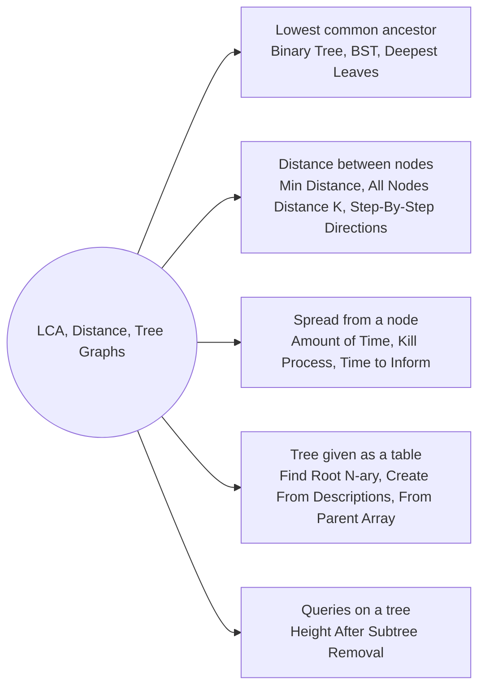

# LCA Distance and Tree Graphs: Pattern Map

> [!TIP]
> **🧠 One picture to keep**
> Questions about **two nodes** or **spreading from a node** need the tree to forget which way is "down":
> 1. **LCA**: the node where the paths from two nodes first meet. Recursion returns "found one / found both".
> 2. **Distance**: `depth(a) + depth(b) - 2 * depth(lca)`, or BFS over an undirected copy.
> 3. **Tree as a graph**: add a parent link (map or array) and every "spread" problem (infection, distance K, kill process, inform time) becomes a BFS.
> 4. **Tables of parents**: manager / ppid / parent arrays are trees stored as edges; build children lists, find the root as the node nobody lists as a child.
> Validity and diameter-type graph problems already live in the Graph folder: [Minimum Height Trees](../../Graph/Topological%20Sort/Minimum%20Height%20Trees.md) and [Validate Binary Tree Nodes](../../Graph/Disjoint%20Set/Validate%20Binary%20Tree%20Nodes.md).

**All animations:** [▶ LCA Distance and Tree Graphs Animations](https://d9-cell.github.io/java-brain/Tree/LCA%20Distance%20and%20Tree%20Graphs/LCA%20Distance%20and%20Tree%20Graphs%20Animations.html) · ⬆ [00 Brain Map](../../00%20Brain%20Map.md)

## Java toolkit
| Need | Java |
|---|---|
| Parent of every node | `Map<TreeNode, TreeNode> parent` filled by one DFS |
| BFS with a visited set | `Set<TreeNode> seen = new HashSet<>(List.of(start))`, add neighbours with `if (seen.add(nb))` |
| Level count of a BFS | `for (int i = q.size(); i > 0; i--)` per level, increment `minutes` outside |
| Path as letters | `StringBuilder` appended on the way back up, then `reverse()` |
| Children lists from edges | `map.computeIfAbsent(parent, k -> new ArrayList<>()).add(child)` |
| Root of an edge list | the node that is never a child (set difference, in-degree 0, or sum / XOR trick) |

## Patterns in this folder

| # | Problem | Pattern | Mantra | Level |
|---|---|---|---|---|
| 1 | [Lowest Common Ancestor of a Binary Tree](Lowest%20Common%20Ancestor%20of%20a%20Binary%20Tree.md) | LCA by recursion, Parent map | FOUND ON BOTH SIDES → ME | Medium |
| 2 | [Lowest Common Ancestor of a Binary Search Tree](Lowest%20Common%20Ancestor%20of%20a%20Binary%20Search%20Tree.md) | LCA with ordering, Walk down | BOTH SMALLER ← , BOTH BIGGER → , ELSE STOP | Medium |
| 3 | [Lowest Common Ancestor of Deepest Leaves](Lowest%20Common%20Ancestor%20of%20Deepest%20Leaves.md) | LCA by recursion, Return depth and node | DEEPER SIDE WINS, TIE → THIS NODE | Medium |
| 4 | [All Nodes Distance K in Binary Tree](All%20Nodes%20Distance%20K%20in%20Binary%20Tree.md) | Parent map + BFS, Tree as a graph | ADD PARENT LINKS, BFS K LEVELS | Medium |
| 5 | [Amount of Time for Binary Tree to Be Infected](Amount%20of%20Time%20for%20Binary%20Tree%20to%20Be%20Infected.md) | Parent map + BFS, Farthest node | FARTHEST NODE FROM START | Medium |
| 6 | [Min Distance between Two Given Nodes of a Binary Tree](Min%20Distance%20between%20Two%20Given%20Nodes%20of%20a%20Binary%20Tree.md) | LCA distance formula | dist = depth(a) + depth(b) − 2·depth(LCA) | Medium |
| 7 | [Step-By-Step Directions From a Binary Tree Node to Another](Step-By-Step%20Directions%20From%20a%20Binary%20Tree%20Node%20to%20Another.md) | LCA path as letters | ROOT PATHS, CUT COMMON PREFIX, U FOR THE REST | Medium |
| 8 | [Kill Process](Kill%20Process.md) | Children lists, BFS / DFS from a node | MAP PARENT → CHILDREN, TRAVERSE FROM KILL | Medium |
| 9 | [Time Needed to Inform All Employees](Time%20Needed%20to%20Inform%20All%20Employees.md) | Org chart as a tree, Longest weighted path | MAX OVER PATHS OF Σ informTime(manager) | Medium |
| 10 | [Height of Binary Tree After Subtree Removal Queries](Height%20of%20Binary%20Tree%20After%20Subtree%20Removal%20Queries.md) | Top two heights per level | DEPTH + BEST OTHER HEIGHT ON THE LEVEL | Hard |
| 11 | [Find Root of N-Ary Tree](Find%20Root%20of%20N-Ary%20Tree.md) | Root of an edge list, Sum / XOR trick | ROOT = ALL NODES − ALL CHILDREN | Medium |
| 12 | [Create Binary Tree From Descriptions](Create%20Binary%20Tree%20From%20Descriptions.md) | Root of an edge list, Map of nodes | MAP VALUE → NODE, ROOT IS NEVER A CHILD | Medium |
| 13 | [Construct Binary Tree from Parent Array](Construct%20Binary%20Tree%20from%20Parent%20Array.md) | Parent array, Create on demand | NODE i UNDER parent[i], CREATE PARENTS FIRST | Medium |

## Suggested learning order
1. [Lowest Common Ancestor of a Binary Search Tree](Lowest%20Common%20Ancestor%20of%20a%20Binary%20Search%20Tree.md), [Lowest Common Ancestor of a Binary Tree](Lowest%20Common%20Ancestor%20of%20a%20Binary%20Tree.md) ⭐, [Lowest Common Ancestor of Deepest Leaves](Lowest%20Common%20Ancestor%20of%20Deepest%20Leaves.md)
2. [Min Distance between Two Given Nodes of a Binary Tree](Min%20Distance%20between%20Two%20Given%20Nodes%20of%20a%20Binary%20Tree.md), [Step-By-Step Directions From a Binary Tree Node to Another](Step-By-Step%20Directions%20From%20a%20Binary%20Tree%20Node%20to%20Another.md)
3. Parent map + BFS: [All Nodes Distance K in Binary Tree](All%20Nodes%20Distance%20K%20in%20Binary%20Tree.md) ⭐, [Amount of Time for Binary Tree to Be Infected](Amount%20of%20Time%20for%20Binary%20Tree%20to%20Be%20Infected.md)
4. Tables: [Kill Process](Kill%20Process.md), [Time Needed to Inform All Employees](Time%20Needed%20to%20Inform%20All%20Employees.md), [Create Binary Tree From Descriptions](Create%20Binary%20Tree%20From%20Descriptions.md), [Construct Binary Tree from Parent Array](Construct%20Binary%20Tree%20from%20Parent%20Array.md), [Find Root of N-Ary Tree](Find%20Root%20of%20N-Ary%20Tree.md)
5. Hard: [Height of Binary Tree After Subtree Removal Queries](Height%20of%20Binary%20Tree%20After%20Subtree%20Removal%20Queries.md)

## Connections to other folders
- [Trees and Advanced Graphs - Pattern Map](../../Graph/Trees%20and%20Advanced%20Graphs/Trees%20and%20Advanced%20Graphs%20-%20Pattern%20Map.md) for diameter, centroids and other graph-on-tree problems
- [DFS and Recursion - Pattern Map](../DFS%20and%20Recursion/DFS%20and%20Recursion%20-%20Pattern%20Map.md) for the return-and-record pattern used by the one-pass solutions
- [Binary Lifting - Pattern Map](../../Binary%20Lifting/Binary%20Lifting%20-%20Pattern%20Map.md) answers LCA queries on huge trees quickly
