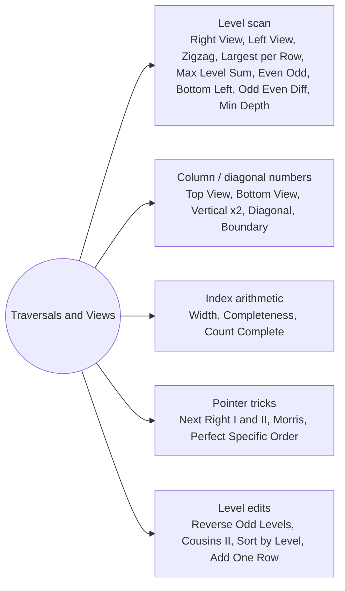

# Traversals and Views: Pattern Map

> [!TIP]
> **🧠 One picture to keep**
> Almost every problem here is **one scan of the tree plus one extra number per node**:
> 1. **Level** (depth): BFS with `q.size()` per level, or DFS carrying `depth`. Right/left views, level max, level sum, zigzag, width.
> 2. **Column** (horizontal distance): left child `-1`, right child `+1`. Top, bottom, vertical views.
> 3. **Diagonal**: left child `+1`, right child `+0`.
> 4. **Pointer tricks**: `next` pointers and Morris threads reuse existing null pointers to avoid extra space.
> Pick BFS when the answer is per level, DFS when you need subtree results.

**All animations:** [▶ Traversals and Views Animations](https://d9-cell.github.io/java-brain/Tree/Traversals%20and%20Views/Traversals%20and%20Views%20Animations.html) · ⬆ [00 Brain Map](../../00%20Brain%20Map.md)

## Java toolkit
| Need | Java |
|---|---|
| Queue | `Queue<TreeNode> q = new LinkedList<>();` (`ArrayDeque` rejects `null`, so do not queue nulls there) |
| One level at a time | `for (int i = q.size(); i > 0; i--) { ... }` |
| Sorted columns | `TreeMap<Integer, Integer>`: `putIfAbsent` keeps the first, `put` keeps the last |
| Group by key | `map.computeIfAbsent(k, x -> new ArrayList<>()).add(v)` |
| Two values per queue entry | two parallel queues, or `new int[]{...}` entries |
| Heap index of children | `2 * i` and `2 * i + 1`, normalise per level to avoid `long` overflow |

## Patterns in this folder

| # | Problem | Pattern | Mantra | Level |
|---|---|---|---|---|
| 1 | [Binary Tree Right Side View](Binary%20Tree%20Right%20Side%20View.md) | Level scan (last of level), Depth-first, right first | LAST OF EVERY LEVEL | Medium |
| 2 | [Left View of Binary Tree](Left%20View%20of%20Binary%20Tree.md) | Level scan (first of level), Depth-first, left first | FIRST OF EVERY LEVEL | Easy |
| 3 | [Top View of Binary Tree](Top%20View%20of%20Binary%20Tree.md) | Column map, BFS with horizontal distance | BFS + COLUMN, FIRST WINS | Medium |
| 4 | [Bottom View of Binary Tree](Bottom%20View%20of%20Binary%20Tree.md) | Column map, BFS with horizontal distance | BFS + COLUMN, LAST WINS | Medium |
| 5 | [Binary Tree Zigzag Level Order Traversal](Binary%20Tree%20Zigzag%20Level%20Order%20Traversal.md) | Level scan, Direction flag | FLIP DIRECTION EACH LEVEL | Medium |
| 6 | [Vertical Tree Traversal](Vertical%20Tree%20Traversal.md) | Column map, BFS with horizontal distance | COLUMN NUMBERS, BFS KEEPS THE ORDER | Medium |
| 7 | [Vertical Order Traversal of a Binary Tree](Vertical%20Order%20Traversal%20of%20a%20Binary%20Tree.md) | Column map, Sort by (col, row, value) | TRIPLES (COL, ROW, VAL), SORT | Hard |
| 8 | [Diagonal Tree Traversal](Diagonal%20Tree%20Traversal.md) | Diagonal number, Right-chain walk | LEFT = NEXT DIAGONAL, RIGHT = SAME | Medium |
| 9 | [Boundary Traversal of Binary Tree](Boundary%20Traversal%20of%20Binary%20Tree.md) | Edge walk, Leaves left to right | LEFT EDGE, LEAVES, RIGHT EDGE REVERSED | Medium |
| 10 | [Boundary Root to Leaf Path Traversal](Boundary%20Root%20to%20Leaf%20Path%20Traversal.md) | Backtracking paths, Two-ended print | ALL PATHS, FIRST FORWARD, LAST BACKWARD | Medium |
| 11 | [Morris Traversal](Morris%20Traversal.md) | Threaded tree, O(1) space traversal | THREAD, VISIT, UNTHREAD | Hard |
| 12 | [Perfect Binary Tree Specific Level Order Traversal](Perfect%20Binary%20Tree%20Specific%20Level%20Order%20Traversal.md) | Mirror pairs, Queue of pairs | ROOT, THEN MIRROR PAIRS | Medium |
| 13 | [Find Largest Value in Each Tree Row](Find%20Largest%20Value%20in%20Each%20Tree%20Row.md) | Level scan, Per-level aggregate | ONE SLOT PER LEVEL, KEEP THE MAX | Medium |
| 14 | [Maximum Level Sum of a Binary Tree](Maximum%20Level%20Sum%20of%20a%20Binary%20Tree.md) | Level scan, Per-level aggregate | SUM PER LEVEL, SMALLEST WINNING LEVEL | Medium |
| 15 | [Even Odd Tree](Even%20Odd%20Tree.md) | Level scan, Monotonic check per level | EVEN LEVEL: ODD ↑, ODD LEVEL: EVEN ↓ | Medium |
| 16 | [Find Bottom Left Tree Value](Find%20Bottom%20Left%20Tree%20Value.md) | Level scan, Last polled node | BFS RIGHT→LEFT, LAST NODE WINS | Medium |
| 17 | [Maximum Width of Binary Tree](Maximum%20Width%20of%20Binary%20Tree.md) | Heap indexing, Level scan | INDEX CHILDREN, WIDTH = LAST − FIRST + 1 | Medium |
| 18 | [Check Completeness of a Binary Tree](Check%20Completeness%20of%20a%20Binary%20Tree.md) | Level scan with nulls, Heap index | FIRST NULL, THEN NO MORE NODES | Medium |
| 19 | [Count Complete Tree Nodes](Count%20Complete%20Tree%20Nodes.md) | Perfect subtree shortcut, Binary search on last level | EDGE HEIGHTS EQUAL → 2^h − 1 | Easy |
| 20 | [Populating Next Right Pointers in Each Node](Populating%20Next%20Right%20Pointers%20in%20Each%20Node.md) | Next pointers, Use the previous level | WIRE LEFT→RIGHT, THEN CROSS TO NEIGHBOUR | Medium |
| 21 | [Populating Next Right Pointers in Each Node II](Populating%20Next%20Right%20Pointers%20in%20Each%20Node%20II.md) | Next pointers, Dummy head per level | DUMMY HEAD, TAIL APPENDS CHILDREN | Medium |
| 22 | [Reverse Odd Levels of Binary Tree](Reverse%20Odd%20Levels%20of%20Binary%20Tree.md) | Mirror swap, Level scan | MIRROR PAIRS SWAP ON ODD LEVELS | Medium |
| 23 | [Cousins in Binary Tree II](Cousins%20in%20Binary%20Tree%20II.md) | Level sums, Subtract the sibling group | LEVEL SUM − (ME + SIBLING) | Medium |
| 24 | [Minimum Number of Operations to Sort a Binary Tree by Level](Minimum%20Number%20of%20Operations%20to%20Sort%20a%20Binary%20Tree%20by%20Level.md) | Level scan, Minimum swaps via cycles | PER LEVEL: CYCLES, LENGTH − 1 | Medium |
| 25 | [Add One Row to Tree](Add%20One%20Row%20to%20Tree.md) | Level splice, Stop at depth − 1 | AT DEPTH−1: NEW KIDS TAKE OLD KIDS | Medium |
| 26 | [Odd Even Level Difference](Odd%20Even%20Level%20Difference.md) | Level parity, Signed sum | ODD LEVELS − EVEN LEVELS | Easy |
| 27 | [Minimum Depth of Binary Tree](Minimum%20Depth%20of%20Binary%20Tree.md) | Level scan, Leaf test | FIRST LEAF IN BFS, ONE CHILD → FOLLOW IT | Easy |

## Suggested learning order
1. Level basics: [Binary Tree Right Side View](Binary%20Tree%20Right%20Side%20View.md) ⭐, [Left View of Binary Tree](Left%20View%20of%20Binary%20Tree.md), [Binary Tree Zigzag Level Order Traversal](Binary%20Tree%20Zigzag%20Level%20Order%20Traversal.md), [Find Largest Value in Each Tree Row](Find%20Largest%20Value%20in%20Each%20Tree%20Row.md)
2. Columns: [Top View of Binary Tree](Top%20View%20of%20Binary%20Tree.md), [Bottom View of Binary Tree](Bottom%20View%20of%20Binary%20Tree.md), [Vertical Tree Traversal](Vertical%20Tree%20Traversal.md), [Vertical Order Traversal of a Binary Tree](Vertical%20Order%20Traversal%20of%20a%20Binary%20Tree.md) ⭐, [Diagonal Tree Traversal](Diagonal%20Tree%20Traversal.md)
3. Level edits: [Reverse Odd Levels of Binary Tree](Reverse%20Odd%20Levels%20of%20Binary%20Tree.md), [Cousins in Binary Tree II](Cousins%20in%20Binary%20Tree%20II.md), [Add One Row to Tree](Add%20One%20Row%20to%20Tree.md)
4. Index tricks: [Maximum Width of Binary Tree](Maximum%20Width%20of%20Binary%20Tree.md), [Check Completeness of a Binary Tree](Check%20Completeness%20of%20a%20Binary%20Tree.md), [Count Complete Tree Nodes](Count%20Complete%20Tree%20Nodes.md)
5. Pointers: [Populating Next Right Pointers in Each Node](Populating%20Next%20Right%20Pointers%20in%20Each%20Node.md), [Populating Next Right Pointers in Each Node II](Populating%20Next%20Right%20Pointers%20in%20Each%20Node%20II.md), [Morris Traversal](Morris%20Traversal.md)
6. Boundary set: [Boundary Traversal of Binary Tree](Boundary%20Traversal%20of%20Binary%20Tree.md), [Boundary Root to Leaf Path Traversal](Boundary%20Root%20to%20Leaf%20Path%20Traversal.md)

## Connections to other folders
- [DFS and Recursion - Pattern Map](../DFS%20and%20Recursion/DFS%20and%20Recursion%20-%20Pattern%20Map.md) uses the same scans but returns values from the subtrees
- [Grid and BFS - Pattern Map](../../Graph/Grid%20and%20BFS/Grid%20and%20BFS%20-%20Pattern%20Map.md) is the same level-by-level BFS on a grid
