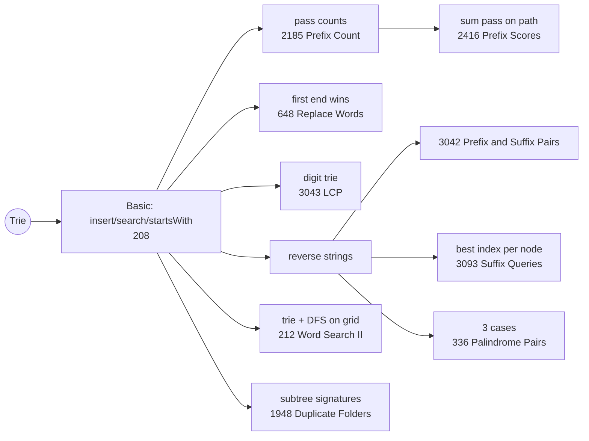

# Trie: Pattern Map

> [!TIP]
> **🧠 One picture to keep**
> A **dictionary's thumb-index tabs**: first letter, then second letter… Words with the same start share the same path; a ★ marks where a real word ends.
> Suffix problems? **Reverse the strings** and they become prefix problems.
> Extra data on nodes is the superpower: `pass` counts (how many words go through), `best` index, `word` itself, palindrome lists.

**All animations:** [▶ Trie Animations](https://d9-cell.github.io/java-brain/Trie/Trie%20Animations.html) · ⬆ [00 Brain Map](../00%20Brain%20Map.md)

## Java toolkit
| Need | Java |
|---|---|
| Node for lowercase letters | `static class Node { Node[] next = new Node[26]; boolean end; }` |
| Child index | `ch - 'a'` (digits: `ch - '0'`, 10 children) |
| Unknown or large alphabet / names | `TreeMap<String, Node> children` (sorted) or `HashMap` |
| Reverse a string | `new StringBuilder(s).reverse().toString()` |
| Count words through a node | `cur = cur.next[i]; cur.pass++;` (after moving down) |

## Patterns in this folder

| # | Problem | Pattern | Mantra | Level |
|---|---|---|---|---|
| 1 | [Implement Trie (Prefix Tree)](Implement%20Trie%20%28Prefix%20Tree%29.md) | Trie basics | WALK, CREATE IF MISSING, ★ AT THE END | Medium |
| 2 | [Counting Words With a Given Prefix](Counting%20Words%20With%20a%20Given%20Prefix.md) | Trie, Pass counts | PASS++ ON INSERT, READ AT PREFIX | Easy |
| 3 | [Count Prefix and Suffix Pairs I](Count%20Prefix%20and%20Suffix%20Pairs%20I.md) | Trie, Reverse for suffix | PREFIX TRIE + REVERSED TRIE | Easy |
| 4 | [Find the Length of the Longest Common Prefix](Find%20the%20Length%20of%20the%20Longest%20Common%20Prefix.md) | Digit trie, HashSet of prefixes | DIGIT TRIE, WALK UNTIL MISSING | Medium |
| 5 | [Replace Words](Replace%20Words.md) | Trie, Shortest prefix | FIRST ★ WINS | Medium |
| 6 | [Sum of Prefix Scores of Strings](Sum%20of%20Prefix%20Scores%20of%20Strings.md) | Trie, Pass counts | PASS++ ON INSERT, SUM PASS ALONG PATH | Hard |
| 7 | [Longest Common Suffix Queries](Longest%20Common%20Suffix%20Queries.md) | Reversed trie, Best value per node | REVERSE, KEEP BEST AT EVERY NODE | Hard |
| 8 | [Palindrome Pairs](Palindrome%20Pairs.md) | Reversed trie, Palindrome check | REVERSED TRIE, 3 CASES: END-EARLY, EXACT, PAL-REST | Hard |
| 9 | [Word Search II](Word%20Search%20II.md) | Trie, DFS backtracking on grid | ONE TRIE, ONE DFS, PRUNE BY TRIE, ERASE FOUND | Hard |
| 10 | [Delete Duplicate Folders in System](Delete%20Duplicate%20Folders%20in%20System.md) | Trie of folders, Subtree serialisation | TRIE, POST-ORDER SIGNATURE, COUNT, PRUNE | Hard |

## Suggested learning order
1. [Implement Trie (Prefix Tree)](Implement%20Trie%20%28Prefix%20Tree%29.md)
2. [Counting Words With a Given Prefix](Counting%20Words%20With%20a%20Given%20Prefix.md) → [Sum of Prefix Scores of Strings](Sum%20of%20Prefix%20Scores%20of%20Strings.md)
3. [Replace Words](Replace%20Words.md), [Find the Length of the Longest Common Prefix](Find%20the%20Length%20of%20the%20Longest%20Common%20Prefix.md)
4. Reverse trick: [Count Prefix and Suffix Pairs I](Count%20Prefix%20and%20Suffix%20Pairs%20I.md) → [Longest Common Suffix Queries](Longest%20Common%20Suffix%20Queries.md)
5. Combine with DFS: [Word Search II](Word%20Search%20II.md)
6. Hard: [Palindrome Pairs](Palindrome%20Pairs.md), [Delete Duplicate Folders in System](Delete%20Duplicate%20Folders%20in%20System.md)

## Connections to other folders
- Replace Words with a HashSet: HashSet/Replace Words
- Palindrome Pairs with a HashMap: HashMap/Palindrome Pairs
- Grid DFS + backtracking (Word Search I): the `Backtracking` folder
- Subtree serialisation (Find Duplicate Subtrees): the `Tree` folder
